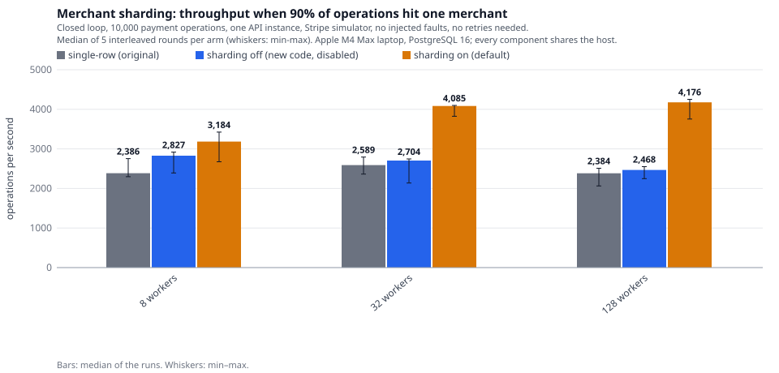

# Payment Ledger

[](https://github.com/KK-0307/payment-ledger/actions/workflows/ci.yml)
[](https://github.com/KK-0307/payment-ledger/actions/workflows/security.yml)

A payment backend in Go and PostgreSQL that stays correct when the processor,
the network, the database or the API process fails in the middle of a request:
Stripe-style idempotency, a double-entry ledger whose invariants PostgreSQL
itself enforces, and a fault-injection benchmark that checks the books against
the processor's own records.

> **Status:** a reference implementation, exercised against Stripe test mode and
> a Stripe-compatible simulator on one laptop. It is not production-certified.

**Start here:**
[Engineering case study](docs/ENGINEERING_CASE_STUDY.md) ·
[Architecture](docs/ARCHITECTURE.md) ·
[Benchmarks](docs/BENCHMARKS.md) ·
[Datasets](docs/DATASETS.md) ·
[Security](SECURITY.md)

### Measured results

Medians of interleaved runs on one Apple M4 Max laptop (database, API, simulator
and load generator share the host); run-to-run spread is 20–70 %, so only
comparisons inside one interleaved sweep are made. Method, variance and
limitations: [BENCHMARKS.md](docs/BENCHMARKS.md).

| What | Result | Details |
|---|---|---|
| Idempotency, processor key and recovery switched off, same faults | **817 cards charged twice per run**; with them on, 0 in every protected run (1,174 oracle-protected runs recorded) | [case study §4](docs/ENGINEERING_CASE_STUDY.md#4-how-correctness-was-tested) |
| Sharding a hot merchant's balance row (90 % of operations on one merchant, 128 workers) | **2,384 → 4,176 ops/s (+75 %)**, p99 111 → 57 ms; no resolvable effect on the suite's Zipf mix | [case study §5](docs/ENGINEERING_CASE_STUDY.md#5-discovery-1-one-merchants-balance-row-was-the-bottleneck) |
| Lock-order deadlock between concurrent same-key requests, found by the benchmark and fixed | **725 → 1,364 ops/s**, about 1,800 deadlocks per five runs → 0, p99 about 1,005 → 105 ms | [case study §6](docs/ENGINEERING_CASE_STUDY.md#6-discovery-2-the-idempotency-and-payment-lock-order-deadlock) |

<p align="center">
  
</p>

### What it does

- **Double-entry ledger** with invariants enforced *inside PostgreSQL*:
  balanced entries are checked by a deferred constraint trigger at commit,
  postings are append-only, and each business event is posted at most once.
- **Stripe-style idempotency keys** with recovery points: retries resume instead
  of repeating side effects, and replays are byte-identical.
- **Unknown outcomes are never guessed.** A timeout after the processor charged
  the card is resolved by an idempotent retry, a recovery worker or a Stripe
  webhook, all through one guarded transition.
- **Transactional outbox** for merchant webhooks (at-least-once, signed).
- **Fault-injection benchmarks** that replay a public card dataset (284,807
  anonymised transactions) while processor responses are lost, the database link
  resets, and API processes are `SIGKILL`ed, then compare the ledger with the
  processor's own records.
- **CI** on every push: build, vet, gofmt, unit and PostgreSQL integration tests,
  race detector, govulncheck and a secret scan.

## Quick start

Requires Go ≥ 1.26 and PostgreSQL 16 binaries (`brew install go postgresql@16`).

```bash
make db-up          # project-local PostgreSQL in .devdb/ on 127.0.0.1:54329
make test           # unit + integration tests against throwaway databases
make build
```

Run the API against the bundled Stripe simulator (two terminals):

```bash
make sim            # Stripe-compatible simulator on :12111, sends signed webhooks to :8080
make api            # API on :8080 (API key: dev_key)
```

```bash
# create a merchant
curl -s localhost:8080/v1/merchants -H 'Authorization: Bearer dev_key' \
  -H 'Idempotency-Key: m-1' -d '{"name":"Coffee Shop"}'

# charge 12.50 EUR (send the same request again: same response, one charge)
curl -s localhost:8080/v1/payments -H 'Authorization: Bearer dev_key' \
  -H 'Idempotency-Key: order-1001' \
  -d '{"merchant_id":"mer_...","amount":1250,"currency":"EUR","payment_method":"pm_card_visa"}'

# its ledger entries, then a partial refund
curl -s localhost:8080/v1/payments/pay_.../ledger -H 'Authorization: Bearer dev_key'
curl -s localhost:8080/v1/payments/pay_.../refunds -H 'Authorization: Bearer dev_key' \
  -H 'Idempotency-Key: refund-1' -d '{"amount":500}'

# re-check every ledger invariant against the database
curl -s localhost:8080/v1/admin/audit -H 'Authorization: Bearer dev_key'
```

## Using real Stripe test mode

The API speaks the real Stripe API, and refuses any key that is not a
test-mode key (`sk_live_…` is rejected at startup).

```bash
export STRIPE_SECRET_KEY=sk_test_...        # from the Stripe dashboard (test mode)
stripe listen --forward-to localhost:8080/v1/webhooks/stripe   # prints whsec_...
DATABASE_URL="$(scripts/devdb.sh url)" API_KEYS=dev_key STRIPE_WEBHOOK_SECRET=whsec_... go run ./cmd/api
```

Use Stripe's test PaymentMethods: `pm_card_visa`,
`pm_card_chargeDeclined`, `pm_card_chargeDeclinedInsufficientFunds`,
`pm_card_radarBlock`, and so on. Benchmark scenario
`10-stripe-test-mode` replays 300 dataset rows against real Stripe through
the fault proxy (`STRIPE_SECRET_KEY` must be set); `11-stripe-test-mode-declines`
adds real declines (not yet run).

## API

All `/v1` endpoints except the webhook require `Authorization: Bearer <API key>`.
Idempotency keys are scoped per API key.

| Method & path | Notes |
|---|---|
| `POST /v1/merchants` | `{"name"}`; `Idempotency-Key` optional |
| `GET /v1/merchants/{id}` | merchant plus its ledger accounts and balances |
| `POST /v1/payments` | **`Idempotency-Key` required.** `{"merchant_id","amount","currency","payment_method","description?","metadata?"}` |
| `GET /v1/payments/{id}` | |
| `GET /v1/payments/{id}/ledger` | every posting for the payment and its refunds |
| `POST /v1/payments/{id}/refunds` | **`Idempotency-Key` required.** `{"amount?"}` (default: the remaining amount) |
| `GET /v1/refunds/{id}` | |
| `GET /v1/accounts/{id-or-code}` and `/postings?before=&limit=` | e.g. `processor_clearing:EUR` |
| `GET /v1/admin/audit` | runs all ledger invariant checks |
| `POST /v1/webhooks/stripe` | Stripe-Signature verified; events deduplicated by id |
| `GET /healthz`, `/readyz`, `/metrics` | liveness, DB readiness, Prometheus |

Responses:

| Status | Meaning |
|---|---|
| `201` | final result, with `status` `succeeded` or `failed`. Stored and replayed for the key (`Idempotent-Replayed: true`) |
| `202` | `needs_review` |
| `409` | same key still in flight after `INFLIGHT_WAIT` (retry with the same key) |
| `422` | key reused with different parameters |
| `503` + `Retryable: true` | outcome not known yet; retry with the **same** key |

## Configuration

| Variable | Default | |
|---|---|---|
| `DATABASE_URL` | — (required) | |
| `API_KEYS` | — (required) | comma-separated bearer tokens |
| `STRIPE_SECRET_KEY` | — (required) | `sk_test_…` only |
| `STRIPE_API_BASE` | `https://api.stripe.com` | point at the simulator or the fault proxy |
| `STRIPE_WEBHOOK_SECRET` | — | comma-separated, for rotation |
| `PROCESSOR_TIMEOUT` | `10s` | per processor call |
| `PROCESSOR_INLINE_RETRIES` | `1` | same-key retries inside a request |
| `LEASE` | `10s` | how long a *dead* holder blocks an in-flight payment; live holders renew it every LEASE/3 |
| `INFLIGHT_WAIT` | `3s` | how long a retry waits for an in-flight payment before answering `409` |
| `RECOVERY_INTERVAL` / `_BATCH` | `1s` / `100` | recovery worker polling |
| `RECOVERY_BACKOFF_BASE` / `_MAX` | `1s` / `1m` | backoff between recovery attempts |
| `RECOVERY_MAX_ATTEMPTS` | `20` | then `needs_review` |
| `LOOKUP_AFTER_ATTEMPTS` | `3` | then also search the processor by metadata |
| `REQUEST_BUDGET` | `30s` | server-side budget, detached from client disconnects |
| `OUTBOX_WEBHOOK_URL` / `_SECRET` | — | merchant event delivery (disabled if unset) |
| `OUTBOX_INTERVAL` / `OUTBOX_CLAIM_FOR` | `200ms` / `30s` | |
| `LEDGER_SHARDS` | `16` | shard accounts per currency for `processor_clearing` and `fee_revenue`; `1` = single rows |
| `LEDGER_PAYABLE_SHARD_RATE` | `25` | postings/s per merchant and currency that one shard of `merchant_payable` is sized for; a merchant above it gets `ceil(rate / this)` shards. `0` = never shard merchants |
| `LEDGER_PAYABLE_MAX_SHARDS` | `16` | upper bound on a hot merchant's payable shards |
| `FEE_BPS` / `FEE_FIXED` | `290` / `30` | 2.9 % + 0.30, illustrative |
| `IDEMPOTENCY_MODE` | `on` | `unsafe-off` = benchmark baseline only |
| `DB_MAX_CONNS`, `LISTEN_ADDR`, `LOG_LEVEL`, `MIGRATE_ON_START` | `32`, `:8080`, `info`, `true` | |

## Benchmarks

```bash
make dataset        # downloads ULB creditcard from OpenML (151 MB), verifies the published MD5
make bench          # 9 simulator scenarios x 3 runs -> bench/results/<scenario>/<run>.json
make bench-report   # markdown summary
```

Each result JSON contains:

- the full scenario and its SHA-256
- the dataset SHA-256
- machine, Go and PostgreSQL details, and the API binary's SHA-256
- per-run latency quantiles, retry and fault counts, and every oracle check

Fault decisions are deterministic functions of (seed, dataset row, attempt
number), so reruns inject the same faults into the same requests. See
[docs/BENCHMARKS.md](docs/BENCHMARKS.md) for the measured numbers and their
caveats.

Headline results (laptop, simulator unless stated; every number is traced to
result files in [`bench/`](bench) in [docs/BENCHMARKS.md](docs/BENCHMARKS.md)):

- **Correctness:** 72 runs under injected faults (lost responses after the
  card was charged, database blackouts, repeated SIGKILLs, everything at
  once) found 0 duplicate charges and 0 ledger/processor mismatches. The same
  faults with idempotency switched off double-charged 817 of 20,000 payments
  in each of 9 runs.
- **Real Stripe test mode:** 300 payments and 11 refunds, 14 responses lost
  after Stripe executed them, 0 duplicate charges in Stripe's own records
  (successful charges only; declines were not run against real Stripe).
- **Found by the benchmark and fixed:** clients giving up after crashes
  (0.26–0.44 % of operations) because a dead process held a payment's lease
  for the whole lease period. With heartbeat leases and a bounded wait, that
  went to 2 of 60,000 operations in database-fault runs and 0 in crash and
  chaos runs.
- **Throughput varies** by up to ~1.8× between sweeps on this laptop for the
  capacity-bound scenarios, for a reason I could not identify; treat it as
  indicative. The main measured bottleneck is row-lock contention on the
  shared system accounts (not yet fixed).

## Layout

```
cmd/api          API server + recovery worker + outbox dispatcher
cmd/bench        benchmark runner and report
cmd/dataset      dataset download / verification / normalization
cmd/stripesim    standalone Stripe simulator (+ optional fault proxy)
internal/ledger       double-entry ledger
internal/payments     payment/refund flows, recovery worker, webhook handling
internal/idempotency  idempotency-key store
internal/processor    processor interface, Stripe adapter, outcome classification
internal/stripe       Stripe HTTP client + webhook signatures
internal/stripesim    in-memory Stripe emulator (idempotency semantics, webhooks)
internal/faultproxy   fault-injecting HTTP and TCP proxies
internal/outbox       transactional outbox dispatcher
internal/audit        invariant checks (used by /v1/admin/audit and the bench oracle)
internal/bench        scenario runner, client, oracle, reporting
internal/dataset      ULB / PaySim parsers and the normalized format
bench/scenarios  benchmark definitions        bench/sweeps, bench/archive  measured results (JSON)
```

## Data sources

- **ULB Credit Card Fraud Detection** (Dal Pozzolo et al., IEEE CIDM 2015),
  via [OpenML dataset 1597](https://www.openml.org/d/1597). These are real
  card transactions by European cardholders over two days in September 2013:
  amounts and timestamps as recorded, other features PCA-anonymized. Used for
  amounts, arrival times and fraud labels.
- **PaySim** (Lopez-Rojas et al., 2016), optional. It is on Kaggle only and
  needs a login, so download it yourself and run
  `go run ./cmd/dataset paysim -input <file>.csv`.

Neither dataset is redistributed in this repository. Check their licenses
before sharing derived files.
