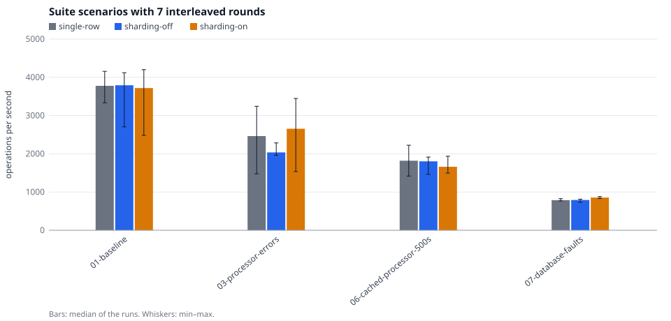
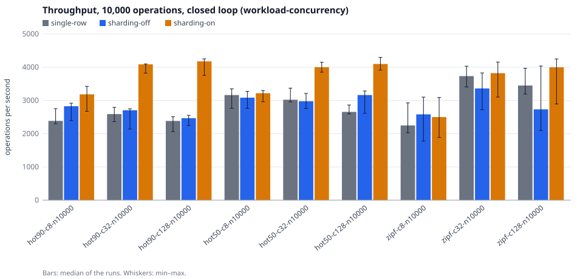
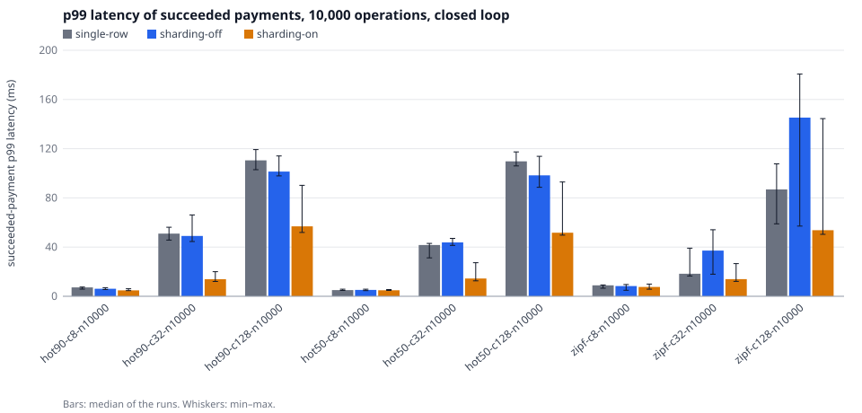
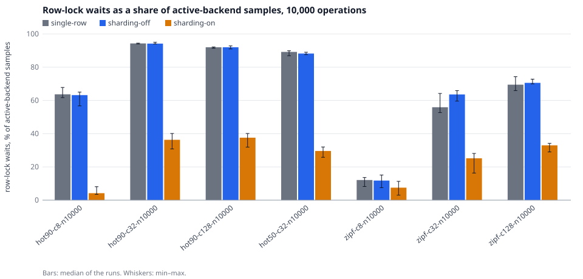
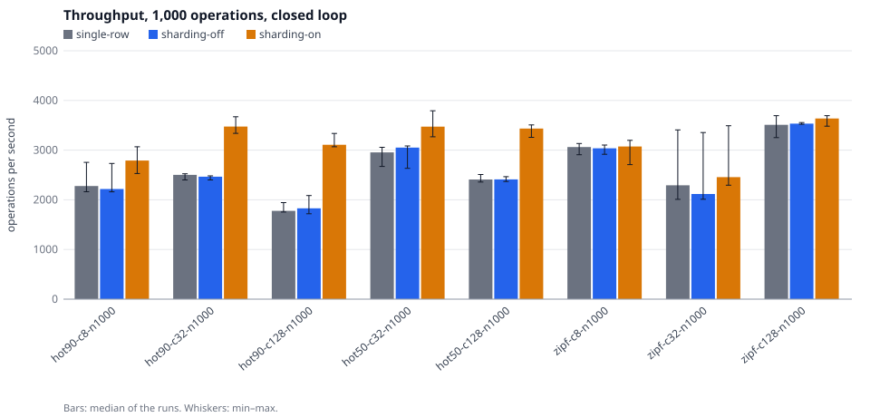
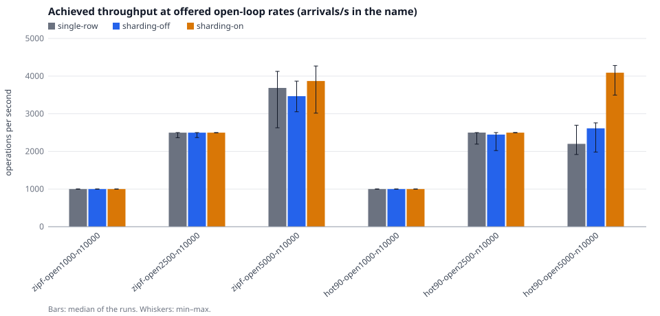

# Benchmarks

A guided summary with charts is in the [engineering case study](ENGINEERING_CASE_STUDY.md);
this page is the full report.

Every number below was produced by this repository's benchmark harness on the
machine described in [Environment](#environment), and copied from
`go run ./cmd/bench report` / `bench matrix`. The raw per-run JSON files are in
[`bench/sweeps/`](../bench/sweeps) (the current sweeps) and
[`bench/archive/`](../bench/archive) (earlier ones); `make bench` writes new
runs to `bench/results/`. Each one embeds the scenario, the dataset hash, the environment and every oracle
check, so any number can be traced back to its run.

## What is measured

Each run:

1. Creates a fresh, migrated PostgreSQL database.
2. Starts the in-process **Stripe simulator**
   ([`internal/stripesim`](../internal/stripesim/sim.go)), which implements
   Stripe's idempotency-key semantics, behind the **HTTP fault proxy**.
3. Starts a **TCP fault proxy** in front of PostgreSQL.
4. Starts the real API binary (`bin/api`) as 1–2 **subprocesses**, so they
   can be SIGKILLed.
5. Creates merchants through the API.
6. Replays a window of the **ULB credit-card dataset** through the public API:
   - amounts are the recorded transaction amounts (EUR)
   - rows labelled fraud are paid with `pm_card_radarBlock` (declined),
     all others with `pm_card_visa`
   - 2 % (5 % in chaos) of successful payments are then refunded in full
7. Injects the scenario's faults.
8. Heals all faults and **drains**: waits until no payment or refund is
   `processing` and the outbox is empty. The drain time is the time to
   reach consistency after faults stop.
9. Runs the **oracle**.

The client ([`internal/bench/client.go`](../internal/bench/client.go))
behaves like a well-written integration:

- 5 s timeout per attempt
- up to 12 attempts with the **same** `Idempotency-Key`
- exponential backoff with full jitter (50 ms base, 2 s cap)
- rotation across API instances
- retries transport errors, 409, 429 and 5xx; nothing else

Load modes:

- **closed**: 32 workers, each sends its next request when the previous one
  finishes. Measures capacity.
- **open**: arrivals follow the dataset's own timestamps, time-scaled to a
  target mean rate. Latency is measured from the scheduled arrival time, so
  queueing is included (no coordinated omission).

Every result also records, per run:

- p50, p90, **p95**, p99, p99.9 and max latency (exact, from the sorted
  sample), for succeeded operations, for all final outcomes and per attempt
- the **final error rate** (operations that ended `gave_up`, `rejected` or
  `needs_review`; a declined card is a correct `failed` outcome, not an
  error) and the **attempt error rate** (attempts with no answer or a 5xx)
- **client retries** (`load.retries`, retries per operation in the tables)
- a `database` section: every 25 ms the harness samples `pg_stat_activity` and
  counts each active backend of the benchmark database under its wait event
  (`Lock/tuple`, `Lock/transactionid`, `IO/WALWrite`, `CPU/none`, …). The
  **row-lock wait share** is the share of those backend samples that were
  waiting on another transaction's row lock. These are samples, not time.
  The same section holds the `pg_stat_database` deltas of **deadlocks**,
  committed and rolled-back transactions, read after the API processes have
  exited (PostgreSQL only publishes a backend's counters after about 10 s idle
  or when it exits)

### The oracle

[`internal/bench/oracle.go`](../internal/bench/oracle.go) and
[`internal/audit`](../internal/audit/audit.go). A run **passes** only if
every check reports zero violations.

| Check | Ground truth |
|---|---|
| `db.*` (12 checks) | the ledger itself: entries balance, cached balances equal posting sums (per shard row, and summed per sharded account), shards of one account are consistent, every currency sums to zero, one capture per succeeded payment and none otherwise, one entry per succeeded refund, refund reservations consistent, fees sane, an outbox event for every final payment state |
| `processor.no_duplicate_charges` | **processor records**: at most one succeeded charge per client request (dataset row) |
| `processor.charges_recorded_in_ledger` | every succeeded processor charge is a succeeded payment with the same processor id and amount |
| `processor.ledger_captures_exist_at_processor` | every succeeded payment exists as a succeeded charge at the processor |
| `processor.refunds_match` | succeeded refunds agree both ways |
| `processor.clearing_matches_processor_net` | `processor_clearing` balance (summed over its shard accounts) = processor's captured − refunded |
| `client.responses_match_final_state` | a `succeeded`/`failed` answer to the client is the final truth (no "failed" for a charged card) |
| `client.duplicate_requests_agree` | two concurrent requests with one `Idempotency-Key` (scenarios with `load.duplicate_fraction`) name the same payment |
| `recovery.no_unresolved_after_drain` | nothing left `processing` or `needs_review` |
| `outbox.all_events_delivered` | the webhook receiver got every outbox event at least once |

### Determinism

Fault decisions are pure functions of (seed, request key, per-key attempt
number), where the request key is the dataset row (`metadata[client_ref]`).
So:

- repeated runs inject the **same** faults into the **same** logical requests
- scenario 05 (unsafe) sees exactly the faults of scenario 04

Every run of 04 and 05 injected exactly 624 lost-after-charge faults and
211 502-after-charge faults (see the fault table below).

What still varies between runs is timing: throughput, latency, and the
interleaving of retries, recovery and crashes. That is why every scenario
runs 3 times per sweep and the tables report the median with the min–max range.

## Scenarios

| # | Scenario | Faults |
|---|---|---|
| 01 | baseline | none; closed loop, 32 workers, 1 instance |
| 02 | open-loop-latency | dataset arrival pattern at 250 tx/s mean; processor latency log-normal, median 150 ms, σ 0.6 |
| 03 | processor-errors | 3 % HTTP 500, 2 % HTTP 429, 1 % TCP reset, all **before** the processor acts |
| 04 | ambiguous-timeouts | 3 % of attempts: processor charges, response hangs 2.5 s then resets (API timeout is 2 s); 1 %: charge then 502. Webhooks off |
| 05 | ambiguous-timeouts-unsafe | 04's faults with `IDEMPOTENCY_MODE=unsafe-off` (ablation) |
| 06 | cached-processor-500s | 2 % of processor executions charge, then return a 500 that is cached under the idempotency key |
| 07 | database-faults | +1 ms per DB response chunk, connection resets at 0.2/s per connection, two 3 s DB blackouts |
| 08 | api-crashes | 2 instances, one SIGKILLed every 4 s (rotating), restarted after 1 s; 40 ms processor latency |
| 09 | chaos | 2 instances with SIGKILLs every 7 s, processor errors before and after charging, cached 500s, webhooks (10 % never delivered), DB resets and a 2 s blackout, outbox receiver failing 5 % |
| 10 | stripe-test-mode | real Stripe test mode, 300 rows at 5 tx/s, 5 % responses dropped after Stripe executed. Needs `STRIPE_SECRET_KEY=sk_test_…`. **Run once**, see [Real Stripe test mode](#real-stripe-test-mode-scenario-10) |
| 11 | stripe-test-mode-declines | like 10 on the densest fraud window (offset 148,620: 21 of 300 rows), fraud rows paid with `pm_card_chargeDeclined`. **Not run** |

The API instances in scenarios 01–09 run with `LEASE=2s` and the defaults for
`INFLIGHT_WAIT` (3 s) and the other settings in
[`internal/bench/runner.go`](../internal/bench/runner.go); a scenario can override
them through `server.env`.

All of 01–09 replay the same 20,000 dataset rows (the first 20,000 rows with
amount ≥ €0.50; 84 of them are labelled fraud) across 200 merchants. The
dataset has no merchant field, so merchants are assigned deterministically
with a Zipf(1.1) skew.

Further scenario families, all without injected faults (the fault scenarios
above are the correctness runs; keeping them apart keeps both interpretable),
are described in [DATASETS.md](DATASETS.md#workload-scenarios):
`bench/scenarios/contention/` (hot-merchant matrix),
`bench/scenarios/workloads/` (bursty and duplicate-request shapes) and
`bench/scenarios/external/` (PaySim and IBM AML replays; not run, see
DATASETS.md).

## Results

There are several generations of results, kept apart on purpose. **Read the
[Environment](#environment) note first: the earlier sweeps ran with
PostgreSQL's data directory inside an iCloud-synced folder.**

| | what | commit / binary | location |
|---|---|---|---|
| **current suite** | 9 scenarios, three arms: *single-row* (original merchant payable), *sharding off* (new code, `LEDGER_PAYABLE_SHARD_RATE=0`) and *sharding on* (default). 7 interleaved rounds for 01, 03, 06, 07; 3 rounds (single-row and on only) for 02, 04, 05, 08, 09. PostgreSQL outside any synced folder | harness `5433eaa`, clean tree; API binaries `8c9688550a1d…` (single-row, built from `e808fd0`) and `8c475b2dd883…` (new code) | [`bench/sweeps/suite-3`](../bench/sweeps/suite-3) |
| **current contention matrix** | 24 hot-merchant scenarios × the same three arms × 5 interleaved rounds (360 runs) | same | [`bench/sweeps/contention-2`](../bench/sweeps/contention-2) |
| **current workloads** | bursty and duplicate-request shapes × three arms × 5 rounds | harness `5433eaa` + burst fix, clean tree; same API binaries | [`bench/sweeps/workloads`](../bench/sweeps/workloads) |
| first sweeps of sharded merchant payables (superseded; synced-folder cluster) | suite twice (3 rounds, 2 arms), contention matrix once (3 rounds, 3 arms) | `e808fd0` / `79cb610` with `git_dirty: true` (see below) | [`suite-1`](../bench/sweeps/suite-1), [`suite-2`](../bench/sweeps/suite-2), [`contention`](../bench/sweeps/contention) |
| sharded system accounts sweep | the sharded-system-accounts design, measured earlier (2026-10-15) | `6720cec` plus uncommitted changes (committed afterwards as `422b351`; unchanged since the sweep as far as file modification times show); binary `cc5c8e34621b…` | [`bench/archive/v4-sharded-system-accounts`](../bench/archive/v4-sharded-system-accounts) |
| pre-sharding rerun | heartbeat leases, single-row system accounts, rerun the same hour as the v4 sweep | `6720cec`; binary `d1dd046e5d57…` | [`bench/archive/v3-single-row-accounts`](../bench/archive/v3-single-row-accounts) |
| heartbeat sweep | same design as the rerun, measured on 2026-10-15 02:40–03:00 UTC | `c3a997e` (clean tree); binary `6e44f2d08ba8…` | [`bench/archive/v2-lease2s-heartbeat`](../bench/archive/v2-lease2s-heartbeat) |
| earlier | `LEASE=6s`, no heartbeat, retries get `409` at once | none (the repository had no commits yet); binary `8ddebb232558…` | [`bench/archive/v1-lease6s-no-heartbeat`](../bench/archive/v1-lease6s-no-heartbeat) |

Everything else (scenarios, dataset, seed, recorded environment) is
identical. Each sweep ran on 2026-10-19 and every suite and matrix sweep is
**interleaved**: for each scenario and round every arm ran once, back to
back, with the arm order rotated between rounds, so that drift on a shared
laptop lands on every arm alike. Scenario 10 (real Stripe) was **not** rerun;
its result is in the heartbeat sweep's directory and was measured with the
single-row design. The numbers in
[Before and after sharded system accounts](#before-and-after-sharded-system-accounts)
come from the v3 and v4 directories.
Values are the median with min–max in parentheses. Latency is per logical
operation, including all client retries, for operations whose final outcome
was `succeeded`. "retries/op" counts client-level retries only.

**Columns in the first table:**

- **oracle**: how many runs passed every check.
- **duplicate charges**: violations of `processor.no_duplicate_charges`.
- **ledger≠processor**: violations of the two processor↔ledger checks combined.
- **client told wrong**: violations of `client.responses_match_final_state`.

### Current results (sharding on, `bench/sweeps/suite-3/adaptive`)

The full sweep with all three arms is in
[Merchant payable sharding: baseline against adaptive](#merchant-payable-sharding-baseline-against-adaptive).
This is the usual `bench report` of the *sharding on* arm.

| scenario | runs | ops | throughput (ops/s) | p50 ms | p99 ms | retries/op | drain s | oracle | duplicate charges | ledger≠processor | client told wrong |
|---|---|---|---|---|---|---|---|---|---|---|---|
| 01-baseline | 7 | 20000 | 3718 (2482–4200) | 7.3 (7.2–9.2) | 20.2 (11.0–56.0) | 0.000 | 0.21 (0.11–0.22) | 7/7 pass | 0 | 0 | 0 |
| 02-open-loop-latency | 3 | 20000 | 247 (247–247) | 155.1 (155.0–155.3) | 617.7 (617.5–618.2) | 0.000 | 0.21 (0.11–0.21) | 3/3 pass | 0 | 0 | 0 |
| 03-processor-errors | 7 | 20000 | 2655 (1537–3448) | 4.8 (3.6–6.1) | 107.3 (104.6–128.9) | 0.003 | 0.11 (0.10–0.22) | 7/7 pass | 0 | 0 | 0 |
| 04-ambiguous-timeouts | 3 | 20000 | 457 (457–457) | 1.0 (1.0–1.1) | 2102.7 (2102.4–2102.9) | 0.001 | 0.11 (0.11–0.21) | 3/3 pass | 0 | 0 | 0 |
| 05-ambiguous-timeouts-unsafe | 3 | 20000 | 459 (459–459) | 0.9 (0.9–0.9) | 2102.9 (2102.9–2103.0) | 0.001 | 0.11 (0.11–0.11) | 0/3 pass | 817 | 817 | 0 |
| 06-cached-processor-500s | 7 | 20000 | 1660 (1497–1936) | 5.2 (2.0–5.8) | 589.9 (581.7–601.6) | 0.059 (0.059–0.059) | 0.11 (0.10–0.21) | 7/7 pass | 0 | 0 | 0 |
| 07-database-faults | 7 | 20000 | 857 (830–882) | 18.7 (18.0–19.1) | 33.8 (31.0–35.9) | 0.028 (0.027–0.029) | 0.13 (0.11–0.21) | 7/7 pass | 0 | 0 | 0 |
| 08-api-crashes | 3 | 20000 | 522 (521–522) | 43.1 (43.0–43.1) | 105.0 (103.8–105.1) | 0.071 (0.071–0.072) | 0.10 (0.10–0.10) | 3/3 pass | 0 | 0 | 0 |
| 09-chaos | 3 | 20000 | 262 (262–262) | 42.3 (42.3–42.3) | 2156.9 (2155.7–2159.5) | 0.065 (0.064–0.066) | 0.20 (0.11–0.21) | 3/3 pass | 0 | 0 | 0 |

Injected faults (median per run):

| scenario | processor 429 | 5xx before | reset before | lost after charge | 502 after charge | sim cached 500 | DB conn resets | DB blackouts | API SIGKILLs |
|---|---|---|---|---|---|---|---|---|---|
| 01-baseline | 0 | 0 | 0 | 0 | 0 | 0 | 0 | 0 | 0 |
| 02-open-loop-latency | 0 | 0 | 0 | 0 | 0 | 0 | 0 | 0 | 0 |
| 03-processor-errors | 433 | 662 | 210 | 0 | 0 | 0 | 0 | 0 | 0 |
| 04-ambiguous-timeouts | 0 | 0 | 0 | 624 | 211 | 0 | 0 | 0 | 0 |
| 05-ambiguous-timeouts-unsafe | 0 | 0 | 0 | 624 | 211 | 0 | 0 | 0 | 0 |
| 06-cached-processor-500s | 0 | 0 | 0 | 0 | 0 | 402 | 0 | 0 | 0 |
| 07-database-faults | 0 | 0 | 0 | 0 | 0 | 0 | 134 (132–137) | 2 | 0 |
| 08-api-crashes | 0 | 0 | 0 | 0 | 0 | 0 | 0 | 0 | 9 |
| 09-chaos | 228 (226–229) | 485 (482–487) | 111 (111–112) | 442 (442–449) | 105 (104–107) | 93 | 132 (129–134) | 1 | 11 |

Final outcomes and who resolved them (summed over runs):

- **01-baseline**: client outcomes `failed=588 succeeded=139412`; final states by resolver `payment:failed:request=588 payment:succeeded:request=139412 refund:succeeded:request=2751`
- **02-open-loop-latency**: client outcomes `failed=252 succeeded=59748`; final states by resolver `payment:failed:request=252 payment:succeeded:request=59748 refund:succeeded:request=1179`
- **03-processor-errors**: client outcomes `failed=588 succeeded=139412`; final states by resolver `payment:failed:request=588 payment:succeeded:request=139412 refund:succeeded:request=2751`
- **04-ambiguous-timeouts**: client outcomes `failed=252 succeeded=59748`; final states by resolver `payment:failed:request=252 payment:succeeded:request=59748 refund:succeeded:request=1179`
- **05-ambiguous-timeouts-unsafe**: client outcomes `failed=252 succeeded=59748`; final states by resolver `payment:failed:request=309 payment:succeeded:request=59748 refund:succeeded:request=1179`
- **06-cached-processor-500s**: client outcomes `failed=588 succeeded=139412`; final states by resolver `payment:failed:request=588 payment:succeeded:recovery=1 payment:succeeded:request=139411 refund:succeeded:request=2751`
- **07-database-faults**: client outcomes `failed=588 gave_up=2 succeeded=139410`; final states by resolver `payment:failed:request=588 payment:succeeded:recovery=314 payment:succeeded:request=139097 refund:succeeded:recovery=8 refund:succeeded:request=2743`
- **08-api-crashes**: client outcomes `failed=252 succeeded=59748`; final states by resolver `payment:failed:recovery=6 payment:failed:request=246 payment:succeeded:recovery=382 payment:succeeded:request=59366 refund:succeeded:recovery=8 refund:succeeded:request=1171`
- **09-chaos**: client outcomes `failed=252 succeeded=59748`; final states by resolver `payment:failed:request=252 payment:succeeded:recovery=252 payment:succeeded:request=59485 payment:succeeded:webhook=11 refund:succeeded:recovery=19 refund:succeeded:request=2954`

Oracle: scenarios 01–04 and 06–09 passed in every run, for all three arms
(108 of 108 runs). Scenario 05 failed in all 6 runs by design (it is the
unsafe ablation); its 817 duplicate charges per run are identical for the
single-row and the sharding-on binary. Scenario 10 was not run in this sweep.

### Before and after sharded system accounts

**What was wrong.** Every capture updated the single `processor_clearing:CUR`
and `fee_revenue:CUR` account rows (through the `postings_apply` trigger), so
captures serialised on those row locks, and the lock was held through the
rest of the transaction. See
[Where the baseline time goes](#where-the-baseline-time-goes).

**What changed.** Each of the two accounts is now 16 shard accounts, picked
by a hash of the payment or refund id; the logical balance is the sum of the
shards ([ARCHITECTURE.md](ARCHITECTURE.md#sharded-system-accounts)). All
audit checks and the oracle still hold; the balance model is otherwise
unchanged.

**Measured effect.** Pre-sharding rerun against current, same hour, 3 runs
each, median:

| scenario | oracle | throughput ops/s | succeeded p50 ms | succeeded p99 ms | slowest op ms | clients gave up |
|---|---|---|---|---|---|---|
| 01-baseline | 3/3 → 3/3 | 2129 → 3635 (+71 %) | 4.6 → 7.5 | 115 → 25 | 344 → 59 | 0 → 0 |
| 03-processor-errors | 3/3 → 3/3 | 2190 → 3091 (+41 %) | 5.1 → 4.6 | 116 → 106 | 256 → 257 | 0 → 0 |
| 06-cached-processor-500s | 3/3 → 3/3 | 1982 → 2144 (+8 %) | 2.8 → 2.2 | 577 → 578 | 747 → 745 | 0 → 0 |
| 07-database-faults | 3/3 → 3/3 | 288 → 868 (3.0×) | 29.7 → 17.2 | 2137 → 44 | 7250 → 6447 | 4 → 1 |
| 08-api-crashes | 3/3 → 3/3 | 520 → 520 | 43.4 → 43.1 | 105 → 105 | 2204 → 2204 | 0 → 0 |
| 09-chaos | 3/3 → 3/3 | 256 → 263 | 43.8 → 42.3 | 2160 → 2157 | 6636 → 6630 | 0 → 0 |
| 02, 04 | 3/3 → 3/3 | unchanged (247, 453) | | | | |

(`make bench-compare` prints the comparison table; the columns above are from
it plus the report.) Scenario 05 failed its oracle 3/3 before and after, as
designed.

How to read it:

- **The gain tracks how much the scenario is limited by database lock
  waits.** The closed-loop scenarios with no injected delay (01, 03, 06)
  speed up by 8–71 %. The scenarios limited by injected processor latency or
  by waiting out leases (02, 04, 08, 09) do not change, as expected.
- **p50 rises in the baseline (4.6 → 7.5 ms) while p99 falls (115 → 25 ms).**
  The mean latency of a closed loop with 32 workers is 32 / throughput by
  Little's law: about 15.0 ms before and 8.8 ms after (derived, not
  separately measured). The long lock-queue tail shrank; why the median rose
  was not investigated.
- **Scenario 07 tripled (288 → 868 ops/s).** This is larger than the
  baseline's gain, and the cause was inferred rather than isolated: the
  injected 1 ms delay on every database response chunk lengthens the time a
  transaction holds the hot rows, which lengthens the lock queue. What was
  checked: one run of scenario 07 with `LEDGER_SHARDS=1` (single rows, new
  code) gave 299 ops/s and p99 2,140 ms, in line with the old binary (288),
  so the gain comes from sharding and not from a time-of-run effect.
- **Throughput is not comparable across sweeps without care.** The
  [earlier section](#earlier-results-lease6s-no-heartbeat) shows 1.8×
  variation between sweeps of the same binary on this laptop. That is why
  the "before" was rerun in the same hour and the key claim below was
  measured with interleaved runs. The rerun's baseline (2,129 ops/s) is
  close to the heartbeat sweep's (2,106), so no large drift was seen that
  day.

**Sensitivity to the shard count** (scenario 01, 20,000 ops, 3 runs per
row, runs interleaved in the order old binary, 1, 4, 16, 64 per round;
oracle passed in all 15; raw files in
[`bench/archive/shard-sensitivity`](../bench/archive/shard-sensitivity)):

| variant | ops/s median (min–max) | p50 ms | p99 ms |
|---|---|---|---|
| old binary (`6720cec`, single rows) | 2102 (2092–2278) | 4.5 | 110.4 |
| new code, `LEDGER_SHARDS=1` | 2067 (2040–2145) | 4.6 | 115.7 |
| `LEDGER_SHARDS=4` | 3129 (3126–3144) | 6.8 | 45.3 |
| `LEDGER_SHARDS=16` (default) | 3769 (3761–3904) | 7.1 | 22.7 |
| `LEDGER_SHARDS=64` | 3972 (3813–3994) | 6.8 | 25.1 |

`LEDGER_SHARDS=1` matches the old binary, so the new code costs nothing when
sharding is off. Going from 16 to 64 shards gained about 5 % in throughput
(the ranges overlap); the default of 16 was chosen before this measurement
and was not tuned.

**What was left.** With system-account sharding the baseline was still
waiting on row locks, mostly on the single `merchant_payable` row of the top
merchant. See [Where the baseline time goes](#where-the-baseline-time-goes).
That is addressed in the next section.

### Merchant payable sharding: baseline against adaptive

#### The change

The Zipf(1.1) merchant mix sends about 21 % of requests to one merchant
(computed from the distribution), and every capture and refund of a merchant
updates its single `merchant_payable:<merchant>:EUR` row. After system-account
sharding that row was the largest row-lock queue (56.5 % of sampled
`Lock/tuple` waiters, see [Where the baseline time goes](#where-the-baseline-time-goes)).

A merchant's payable account is now spread over `ceil(rate / 25)` shard rows (at
most 16) once the merchant's posting rate passes 25 per second, estimated per
API process; below that it stays the single row
([ARCHITECTURE.md](ARCHITECTURE.md#sharded-merchant-payable-accounts)). The
shard is chosen by the same hash as the system accounts. No DB-enforced
invariant, audit check or oracle check was weakened. The defaults (25 per
second per shard, at most 16) were chosen by reasoning and **not tuned**; no
other values were measured.

#### Method

- **Arms.** *single-row*: the original merchant-payable implementation, the
  API binary built from commit `e808fd0` (the parent of the change; system
  accounts already sharded). *sharding off*: the new binary with
  `LEDGER_PAYABLE_SHARD_RATE=0` (recorded in each result as `env_overrides`);
  it should behave like single-row and shows how far two runs of equivalent
  code differ. *sharding on*: the new binary with its defaults.
- **Same everything else.** The scenario files, seeds, dataset (SHA-256 in
  every result), harness binary, PostgreSQL cluster and API settings are
  identical for the arms. Each run creates a fresh migrated database. The only
  differences are the API binary and the one environment variable above.
- **Interleaving.** `scripts/bench-interleaved.sh` runs, for each scenario and
  round, every arm once, back to back, rotating which arm goes first. A *round*
  therefore compares runs that shared the machine's momentary state. The tables
  report each arm's median with min–max, the run-to-run spread
  `(max − min) / median`, and in how many rounds an arm's run was faster than
  the single-row run of the same round (rounds are paired by start order; no
  significance test beyond that was applied, and no multiple-comparison
  correction. With 5 rounds, 5/5 has a one-sided sign-test p-value of 0.031).
- **Measures.** Throughput (operations per second, closed loop: the load phase
  duration; open loop: against the offered rate), p50/p95/p99 latency of
  succeeded operations, final and attempt error rates, client retries per
  operation, sampled row-lock wait share, deadlocks and rolled-back
  transactions from `pg_stat_database`
  ([definitions](#what-is-measured)), and the oracle after every run. The
  oracle includes every ledger invariant, so it covers duplicate postings
  (one capture and one refund entry per event), lost updates (cached balances
  equal posting sums, per shard row and per logical account) and unbalanced
  journal entries (every entry sums to zero).
- **Reproduce.** See [Reproduce](#environment) below.

#### Result 1: the suite

Seven interleaved rounds for 01, 03, 06, 07; three rounds, single-row against
sharding on, for the scenarios limited by injected latency (02, 04, 05, 08,
09). Throughput is in operations per second.

| scenario | arm | runs | throughput ops/s | run-to-run spread | vs single-row | rounds faster than single-row | p50 ms | p95 ms | p99 ms |
|---|---|---|---|---|---|---|---|---|---|
| 01-baseline | single-row | 7 | 3778 (3334–4158) | 21.8 % | — | — | 7.1 (7.0–7.6) | 12.1 (11.4–17.8) | 23.9 (15.6–31.1) |
| 01-baseline | sharding-off | 7 | 3792 (2705–4121) | 37.3 % | +0.4 % | 3/7 | 7.2 (6.9–8.2) | 13.3 (11.6–28.6) | 24.9 (16.4–65.9) |
| 01-baseline | sharding-on | 7 | 3718 (2482–4200) | 46.2 % | -1.6 % | 3/7 | 7.3 (7.2–9.2) | 13.1 (9.3–24.0) | 20.2 (11.0–56.0) |
| 02-open-loop-latency | single-row | 3 | 247 (247–247) | 0.0 % | — | — | 155.4 (155.3–155.4) | 407.9 (407.1–407.9) | 617.5 (617.5–624.2) |
| 02-open-loop-latency | sharding-on | 3 | 247 (247–247) | 0.0 % | +0.0 % | 1/3 | 155.1 (155.0–155.3) | 407.3 (407.1–407.3) | 617.7 (617.5–618.2) |
| 03-processor-errors | single-row | 7 | 2464 (1476–3243) | 71.7 % | — | — | 4.6 (3.7–8.0) | 102.6 (102.3–103.7) | 109.2 (105.2–132.8) |
| 03-processor-errors | sharding-off | 7 | 2036 (1961–2284) | 15.9 % | -17.4 % | 1/7 | 6.1 (4.5–7.8) | 103.2 (102.5–103.6) | 116.5 (113.8–135.8) |
| 03-processor-errors | sharding-on | 7 | 2655 (1537–3448) | 71.9 % | +7.8 % | 4/7 | 4.8 (3.6–6.1) | 102.9 (102.3–103.7) | 107.3 (104.6–128.9) |
| 04-ambiguous-timeouts | single-row | 3 | 456 (448–457) | 1.9 % | — | — | 1.1 (1.0–1.9) | 6.6 (5.5–8.5) | 2102.8 (2102.7–2103.7) |
| 04-ambiguous-timeouts | sharding-on | 3 | 457 (457–457) | 0.1 % | +0.1 % | 2/3 | 1.0 (1.0–1.1) | 6.2 (6.2–6.9) | 2102.7 (2102.4–2102.9) |
| 05-ambiguous-timeouts-unsafe | single-row | 3 | 459 (458–459) | 0.0 % | — | — | 0.9 (0.9–0.9) | 5.0 (5.0–5.0) | 2102.9 (2102.8–2102.9) |
| 05-ambiguous-timeouts-unsafe | sharding-on | 3 | 459 (459–459) | 0.0 % | -0.0 % | 1/3 | 0.9 (0.9–0.9) | 5.0 (5.0–5.2) | 2102.9 (2102.9–2103.0) |
| 06-cached-processor-500s | single-row | 7 | 1820 (1417–2225) | 44.4 % | — | — | 2.6 (1.8–4.3) | 11.8 (4.8–32.0) | 583.9 (575.7–605.3) |
| 06-cached-processor-500s | sharding-off | 7 | 1802 (1463–1914) | 25.0 % | -1.0 % | 2/7 | 3.1 (1.9–6.5) | 17.5 (10.2–23.9) | 591.0 (583.0–608.2) |
| 06-cached-processor-500s | sharding-on | 7 | 1660 (1497–1936) | 26.5 % | -8.8 % | 3/7 | 5.2 (2.0–5.8) | 15.8 (9.8–20.4) | 589.9 (581.7–601.6) |
| 07-database-faults | single-row | 7 | 788 (767–826) | 7.5 % | — | — | 19.5 (18.0–19.8) | 37.5 (31.5–40.9) | 62.0 (50.7–85.5) |
| 07-database-faults | sharding-off | 7 | 793 (733–814) | 10.2 % | +0.6 % | 3/7 | 19.1 (18.3–19.8) | 35.2 (31.0–40.6) | 55.4 (50.7–112.2) |
| 07-database-faults | sharding-on | 7 | 857 (830–882) | 6.0 % | +8.7 % | 7/7 | 18.7 (18.0–19.1) | 24.8 (23.6–25.0) | 33.8 (31.0–35.9) |
| 08-api-crashes | single-row | 3 | 520 (519–522) | 0.6 % | — | — | 43.0 (43.0–43.1) | 76.2 (76.0–76.2) | 105.8 (105.4–106.0) |
| 08-api-crashes | sharding-on | 3 | 522 (521–522) | 0.2 % | +0.3 % | 2/3 | 43.1 (43.0–43.1) | 76.2 (76.0–76.2) | 105.0 (103.8–105.1) |
| 09-chaos | single-row | 3 | 263 (260–263) | 1.1 % | — | — | 42.3 (42.3–42.4) | 141.8 (141.5–143.0) | 2161.9 (2159.4–2161.9) |
| 09-chaos | sharding-on | 3 | 262 (262–262) | 0.1 % | -0.2 % | 1/3 | 42.3 (42.3–42.3) | 142.2 (141.9–142.5) | 2156.9 (2155.7–2159.5) |

Chart (median, whiskers min–max): 

What it shows:

- **Scenarios 02, 04, 05, 08, 09 do not move** (changes of −0.2 % to +0.3 %,
  spreads under 2 %): they are limited by injected processor latency, lease
  waits or the offered rate, not by row locks.
- **Scenario 07 (database faults) improves consistently:** +8.7 %
  (788 → 857 ops/s), sharding on faster than single-row in **7 of 7 rounds**,
  p99 62 → 34 ms, and its spread is small (6–7 %). The same direction was
  seen in both earlier sweeps (+4.0 % and +4.1 %, 3 of 3 pairs each time, p99 39 → 27 ms
  and 39 → 28 ms). The injected 1 ms per database round trip lengthens how long
  a transaction holds its rows, which is where lock queues hurt most.
- **Scenario 01 (baseline), 03 (processor errors) and 06 (cached 500s) show no
  effect that this method can resolve.** Medians: 01 −1.6 % (3/7 rounds), 03
  +7.8 % (4/7), 06 −8.8 % (3/7), with spreads of 22–72 % within a single arm.
  The *sharding off* arm, whose code path equals the single-row one, differs
  from single-row by +0.4 %, −17.4 % and −1.0 % in the same three scenarios,
  so differences of this size occur between equivalent configurations. The
  earlier synced-folder sweeps measured 01 at +4.4 % and +5.3 % (6 of 6 pairs
  favouring sharding), 03 at +2.7 % and −6.0 %, and 06 at +0.5 % and +0.2 %.
- **The row-lock queue did shrink everywhere it existed.** Sampled row-lock
  wait share, single-row → sharding on: 01 57 % → 23 %, 03 38 % → 17 %, 06
  23 % → 13 %, 07 64 % → 30 %. In 01 the lock queue fell by more than half
  while throughput did not move, which means the limit in the suite's
  baseline is elsewhere (see Limitations). I did not find a mechanism by which
  sharding could slow 03 or 06 down (the row-lock share fell in both; the
  per-run lock-wait numbers are in the
  [full matrix](results/suite-matrix.md)), and the −6.0 % and −8.8 %
  observations did not reproduce in the other sweeps (the same scenario
  changed sign between sweeps), so I treat them as noise. They are not
  proven to be.

The oracle passed in all 108 runs of scenarios 01–04 and 06–09 (all arms), and
failed in all 6 runs of scenario 05 by design, with the same 817 duplicate
charges per run for both binaries.

#### Result 2: the hot-merchant contention matrix

24 scenarios, each run 5 times per arm (360 runs, 2,385,000 payment
operations). All use the suite's dataset window and settings (one API
instance, 32 database connections, no injected faults, 2 % refunds) and differ
only in the merchant mix, the load and the number of operations:

- **mix:** `zipf` = the suite's Zipf(1.1) mix over 200 merchants; `hot50` /
  `hot90` = 50 % / 90 % of operations go to one merchant
  (`hot_merchant_fraction`)
- **load:** closed loop with 8, 32 or 128 workers (offered load grows with the
  workers), or open loop at 1,000, 2,500 and 5,000 arrivals per second with at
  most 256 in flight
- **operations:** 1,000 and 10,000 (open loop: 10,000)

| workload | load | ops | single-row ops/s | sharding off ops/s | sharding on ops/s | on vs single-row | rounds on faster (of 5) | on vs off | p99 ms single-row → on | row-lock share single-row → on |
|---|---|---|---|---|---|---|---|---|---|---|
| hot90 | 8 workers | 1000 | 2277 (2163–2754) | 2216 (2160–2731) | 2790 (2528–3068) | +22 % | 5/5 | +26 % | 9 → 8 | 63 % → 11 % |
| hot90 | 8 workers | 10000 | 2386 (2297–2754) | 2827 (2392–2918) | 3184 (2673–3424) | +33 % | 4/5 | +13 % | 7 → 5 | 64 % → 4 % |
| hot90 | 32 workers | 1000 | 2501 (2399–2524) | 2465 (2400–2482) | 3474 (3338–3671) | +39 % | 5/5 | +41 % | 49 → 45 | 94 % → 76 % |
| hot90 | 32 workers | 10000 | 2589 (2363–2793) | 2704 (2138–2746) | 4085 (3823–4099) | +58 % | 5/5 | +51 % | 51 → 14 | 94 % → 36 % |
| hot90 | 128 workers | 1000 | 1777 (1753–1943) | 1829 (1719–2086) | 3108 (3067–3335) | +75 % | 5/5 | +70 % | 136 → 95 | 90 % → 66 % |
| hot90 | 128 workers | 10000 | 2384 (2064–2510) | 2468 (2247–2552) | 4176 (3754–4252) | +75 % | 5/5 | +69 % | 111 → 57 | 92 % → 38 % |
| hot90 | open loop, 1000/s offered | 10000 | 1000 (1000–1000) | 1000 (1000–1000) | 1000 (1000–1000) | -0 % | 1/5 | +0 % | 130 → 83 | 87 % → 35 % |
| hot90 | open loop, 2500/s offered | 10000 | 2499 (2193–2499) | 2446 (2022–2499) | 2499 (2499–2499) | -0 % | 2/5 | +2 % | 829 → 182 | 94 % → 38 % |
| hot90 | open loop, 5000/s offered | 10000 | 2201 (1918–2695) | 2613 (1984–2758) | 4092 (3496–4281) | +86 % | 5/5 | +57 % | 2563 → 666 | 93 % → 38 % |
| hot50 | 8 workers | 1000 | 2587 (2498–2962) | 2648 (2529–3107) | 2573 (2477–3090) | -1 % | 2/5 | -3 % | 7 → 7 | 20 % → 5 % |
| hot50 | 8 workers | 10000 | 3162 (2765–3348) | 3085 (2765–3274) | 3218 (2960–3298) | +2 % | 2/5 | +4 % | 5 → 5 | 23 % → 5 % |
| hot50 | 32 workers | 1000 | 2954 (2672–3056) | 3052 (2633–3085) | 3472 (3269–3792) | +18 % | 5/5 | +14 % | 44 → 40 | 85 % → 58 % |
| hot50 | 32 workers | 10000 | 3021 (2959–3370) | 2977 (2761–3210) | 4001 (3850–4149) | +32 % | 5/5 | +34 % | 42 → 14 | 89 % → 30 % |
| hot50 | 128 workers | 1000 | 2409 (2358–2510) | 2410 (2369–2466) | 3434 (3257–3507) | +43 % | 5/5 | +42 % | 114 → 78 | 87 % → 54 % |
| hot50 | 128 workers | 10000 | 2655 (2596–2864) | 3163 (2613–3284) | 4096 (3913–4296) | +54 % | 5/5 | +30 % | 110 → 52 | 87 % → 33 % |
| zipf | 8 workers | 1000 | 3061 (2907–3133) | 3037 (2917–3102) | 3074 (2708–3197) | +0 % | 2/5 | +1 % | 6 → 6 | 9 % → 0 % |
| zipf | 8 workers | 10000 | 2249 (2026–2926) | 2583 (1774–3101) | 2500 (1885–3089) | +11 % | 3/5 | -3 % | 9 → 8 | 12 % → 8 % |
| zipf | 32 workers | 1000 | 2292 (2008–3408) | 2117 (2012–3354) | 2457 (2294–3491) | +7 % | 4/5 | +16 % | 54 → 40 | 61 % → 37 % |
| zipf | 32 workers | 10000 | 3732 (3407–4031) | 3361 (2721–3829) | 3820 (3101–4154) | +2 % | 4/5 | +14 % | 18 → 14 | 56 % → 25 % |
| zipf | 128 workers | 1000 | 3510 (3252–3694) | 3533 (3519–3555) | 3638 (3482–3693) | +4 % | 3/5 | +3 % | 71 → 70 | 69 % → 45 % |
| zipf | 128 workers | 10000 | 3449 (3193–3969) | 2732 (2096–4034) | 3996 (2893–4248) | +16 % | 4/5 | +46 % | 87 → 54 | 70 % → 33 % |
| zipf | open loop, 1000/s offered | 10000 | 1000 (1000–1000) | 1000 (1000–1000) | 1000 (1000–1000) | -0 % | 0/5 | -0 % | 94 → 117 | 50 % → 23 % |
| zipf | open loop, 2500/s offered | 10000 | 2499 (2364–2499) | 2499 (2368–2499) | 2498 (2497–2499) | -0 % | 3/5 | -0 % | 650 → 479 | 67 % → 30 % |
| zipf | open loop, 5000/s offered | 10000 | 3686 (2627–4126) | 3468 (3053–3867) | 3870 (3016–4269) | +5 % | 3/5 | +12 % | 875 → 762 | 69 % → 32 % |

Charts: 





The complete tables (p50/p95/p99, error rates, retries, rollbacks, deadlocks,
oracle) are in [results/contention-matrix.md](results/contention-matrix.md);
one CSV row per run is produced by `bench matrix -csv`.

What it shows:

- **With a hot merchant and enough concurrency the gain is large and
  consistent.** At 90 % of operations to one merchant and 32 or 128 workers,
  sharding on is +39 % to +75 % over single-row, faster in 5 of 5 rounds in
  every one of those cells; p99 at 10,000 operations falls from 51 to 14 ms
  (32 workers) and from 111 to 57 ms (128 workers); the row-lock wait share
  from 92–94 % to 36–38 % (10,000 operations; 90 → 66 % and 94 → 76 % at 1,000). With 50 % to one merchant and 32 or 128 workers:
  +18 % to +54 %, 5 of 5 rounds in each cell.
- **The sharded arm converges to about 4,000 ops/s** at 32 and 128 workers in
  every mix (hot90 4,085 and 4,176, hot50 4,001 and 4,096, zipf 3,820 and
  3,996 at 10,000 operations), the level of the uncontended suite baseline
  (scenario 01: 3,700–4,200). Sharding removes the cost of skew; it does not
  raise that ceiling.
- **At 8 workers** a 90 % hot merchant gains +22 % and +33 % (5/5 and 4/5
  rounds), but a 50 % hot merchant does not (−1 %, +2 %; 2/5 rounds): with few
  concurrent writers the row queue is short.
- **The suite's Zipf mix shows no effect the method can resolve** (+0 % to
  +16 %, faster in 2 to 4 of 5 rounds, never 5/5). The sharding-off arm, which
  equals single-row by construction, differs from single-row by −21 % to
  +15 % in these cells, so changes under roughly ±20 % are not established. The
  row-lock wait share still falls (zipf 32 workers, 10,000 operations: 56 % →
  25 %).
- **Open loop.** Offered rates the single-row system can carry (1,000 and
  2,500 per second) are carried by all three arms (achieved throughput equals
  the offered rate), so throughput cannot differ; the latency tail does: with
  90 % to one merchant at 2,500 per second, p99 falls from 829 to 182 ms. At
  5,000 offered per second (beyond capacity) the hot90 arm achieves 4,092 ops/s
  against 2,201 (+86 %, 5/5 rounds; p99 2,563 → 666 ms), the zipf mix +5 %
  (3/5 rounds, not resolved).
- **1,000 operations (runs of 0.3–0.6 s)** behave like the long runs: hot90 at
  32 and 128 workers +39 % and +75 %, 5/5 rounds. That the gain appears in runs shorter than a second shows that the rate
  estimator engages within that time.
- **Sharding off tracks single-row, within the noise.** The two differ by
  more than 10 % in 5 of 24 cells (+19 %, +18 %, +19 %, +15 % and −21 %; hot50
  with 128 workers, hot90 with 8 workers, hot90 open loop at 5,000/s, zipf with
  8 workers, zipf with 128 workers; all at 10,000 operations). The code paths
  are equivalent with the feature off, so these differences are noise or an
  effect of the arm's position within a round (the arm order is rotated, but 5
  rounds do not balance the three positions exactly); four of the five favour
  the sharding-off arm. This is why *sharding on* is also shown against
  *sharding off*: e.g. hot90, 8 workers, 10,000 operations is +33 % against
  single-row but +13 % against sharding off, and the +33 % should be read with
  that in mind.

#### Correctness

Across the contention matrix (360 runs, 2,385,000 operations, about 5.2
million committed transactions): **the oracle passed in 360 of 360 runs**;
ledger invariant violations 0; duplicate charges 0; **deadlocks 0**
(`pg_stat_database`); rolled-back transactions 0; final error rate 0 %;
attempt error rate 0 %; client retries 0. Across the 108 protected suite runs
the oracle passed 108 of 108, with 0 deadlocks and 0 duplicate charges; the
rolled-back transactions are confined to scenarios 07–09 (database resets and
API crashes; for scenario 07, 721 single-row, 731 sharding off and 647 sharding
on over 7 runs each) and one per arm in scenario 02. These are the results of the runs listed, not a proof: a rare
interleaving not hit in these runs would not show here. What backs the
guarantees structurally is that the invariants are enforced by PostgreSQL
(deferred balance trigger, append-only triggers, the `postings_apply` trigger
and the unique journal key), that account rows are locked in one global order
(shard rows are ordinary rows, so deadlock freedom is unchanged), and the
tests in `internal/payments` and `internal/ledger`, including concurrent
captures on one hot merchant with the shard count changing underneath
(`TestHotMerchantConcurrentCaptures`).

#### First sweeps (superseded)

The first measurement of this change, 3 rounds per arm on a cluster inside an
iCloud-synced folder, is kept in `bench/sweeps/suite-1`, `suite-2` and
`contention`. Its conclusions agree with the above where an effect is large
(hot merchant, scenario 07) and are noisier everywhere else. Its scenario 01
gain of +4 to +5 % did not reproduce in the cleaner 7-round measurement
(−1.6 %). Its result files record `git_dirty: true` because the harness's
dirty check did not yet exclude `bench/sweeps` (it now does); the source tree
was clean at the start (commit `d065f06`) and only harness and dataset code,
not the API, changed afterwards.

#### Limitations

- **One laptop; everything shares its cores.** PostgreSQL, the API process, the
  simulator, the fault proxies and the load generator run on the same 14
  cores, next to a desktop session. The sharded arm's ceiling of about 4,000
  ops/s may be the load generator or the API rather than the database; that
  was not separated (no CPU profile was taken).
- **Run-to-run variation is large.** Spreads of 20–70 % within one arm are
  common in the 1 s to 5 s closed-loop runs, and it is time-correlated
  (a slow period hits every arm that is running then, which is why the arms
  are interleaved). Five or seven rounds resolve effects above roughly 20 %;
  smaller effects are not claimed.
- **Estimated rate per API process.** With two API instances each sees half of
  a merchant's traffic and shards later. All measurements here used one
  instance (the crash scenarios 08–09 use two, and are latency-bound).
- **Not tuned.** The per-shard rate (25/s) and the cap (16) were not varied.
- **The burst on a cold start** is posted to a single row until the estimate
  catches up (well under a second here); with 1,000-operation runs that is
  part of what is measured.
- **Simulator, not Stripe.** See the general caveats.

### Workload shapes: steady, bursty, duplicate requests

Scenarios in `bench/scenarios/workloads/`, no injected faults, 20,000
operations of the ULB dataset window, one API instance, three arms (single-row,
sharding off, sharding on), 5 interleaved rounds (90 runs; the API without
the later lock-order fix, see the next section). Each shape runs on the suite's
Zipf mix and on a 90 % hot-merchant mix:

- **steady**: closed loop, 32 workers (the reference)
- **bursty**: open loop, mean 1,500 arrivals/s delivered in 1 s bursts of
  6,000/s every 4 s (`load.burst`), at most 256 in flight. Latency is measured
  from the scheduled arrival, so the queue inside a burst counts
- **duplicates**: closed loop, 32 workers; 20 % of operations are sent twice
  at the same time with the same `Idempotency-Key` (`load.duplicate_fraction`)

| scenario | arm | runs | throughput ops/s | run-to-run spread | vs single-row | rounds faster than single-row | p50 ms | p95 ms | p99 ms |
|---|---|---|---|---|---|---|---|---|---|
| bursty-hot90 | single-row | 5 | 1350 (1260–1486) | 16.7 % | — | — | 1132.6 (603.2–1509.3) | 3018.6 (2005.7–3761.9) | 3394.2 (2067.4–4167.5) |
| bursty-hot90 | sharding-off | 5 | 1332 (1320–1350) | 2.3 % | -1.3 % | 3/5 | 1429.8 (622.8–1509.7) | 2760.2 (1877.1–3187.1) | 3166.1 (2345.5–3375.4) |
| bursty-hot90 | sharding-on | 5 | 1511 (1493–1539) | 3.0 % | +11.9 % | 5/5 | 382.3 (227.1–420.4) | 883.5 (717.6–1427.5) | 1025.8 (796.4–1437.2) |
| bursty-zipf | single-row | 5 | 1452 (1444–1520) | 5.2 % | — | — | 506.2 (287.6–729.7) | 1633.6 (1149.8–2124.7) | 1755.5 (1307.5–2290.2) |
| bursty-zipf | sharding-off | 5 | 1451 (1445–1454) | 0.6 % | -0.0 % | 2/5 | 597.2 (449.7–692.9) | 1878.4 (1104.7–2098.1) | 1888.5 (1422.7–2255.8) |
| bursty-zipf | sharding-on | 5 | 1504 (1499–1514) | 1.0 % | +3.6 % | 4/5 | 448.2 (356.1–457.9) | 1295.0 (873.5–1334.7) | 1311.2 (881.6–1375.5) |
| duplicates-hot90 | single-row | 5 | 758 (739–791) | 6.9 % | — | — | 3.4 (1.3–4.1) | 16.7 (11.3–20.5) | 1004.7 (1002.8–1005.3) |
| duplicates-hot90 | sharding-off | 5 | 768 (734–825) | 11.8 % | +1.3 % | 3/5 | 2.5 (1.5–4.2) | 17.2 (7.0–23.2) | 1004.3 (1002.7–1005.2) |
| duplicates-hot90 | sharding-on | 5 | 706 (698–719) | 2.9 % | -6.9 % | 0/5 | 3.7 (2.4–3.9) | 22.1 (18.3–26.0) | 1004.6 (1004.4–1005.9) |
| duplicates-zipf | single-row | 5 | 704 (671–748) | 10.9 % | — | — | 3.8 (2.7–4.2) | 22.2 (14.9–27.3) | 1005.1 (1004.6–1005.5) |
| duplicates-zipf | sharding-off | 5 | 753 (739–785) | 6.1 % | +7.0 % | 5/5 | 2.2 (1.3–3.3) | 15.7 (12.5–20.4) | 1004.7 (1003.7–1005.1) |
| duplicates-zipf | sharding-on | 5 | 737 (666–934) | 36.3 % | +4.7 % | 2/5 | 3.2 (1.3–4.0) | 17.9 (3.0–23.3) | 1004.5 (1001.7–1005.6) |
| steady-hot90 | single-row | 5 | 1459 (1321–1525) | 14.0 % | — | — | 9.8 (9.3–10.3) | 74.4 (70.4–85.2) | 125.0 (119.9–138.2) |
| steady-hot90 | sharding-off | 5 | 1442 (1311–1889) | 40.1 % | -1.2 % | 2/5 | 10.0 (8.3–10.4) | 73.8 (56.5–85.1) | 117.4 (114.5–143.6) |
| steady-hot90 | sharding-on | 5 | 3101 (2738–3250) | 16.5 % | +112.5 % | 5/5 | 9.2 (8.8–10.6) | 15.9 (15.3–17.4) | 22.4 (20.7–24.1) |
| steady-zipf | single-row | 5 | 2713 (2334–3256) | 34.0 % | — | — | 9.7 (8.5–10.0) | 20.6 (17.1–34.9) | 33.3 (25.9–53.5) |
| steady-zipf | sharding-off | 5 | 2640 (2257–3144) | 33.6 % | -2.7 % | 2/5 | 9.3 (8.3–10.8) | 25.9 (16.4–30.8) | 44.5 (26.0–58.8) |
| steady-zipf | sharding-on | 5 | 3131 (2330–3337) | 32.2 % | +15.4 % | 3/5 | 9.4 (8.7–11.5) | 15.6 (12.4–18.7) | 21.0 (15.0–31.2) |

- **Steady, hot merchant:** +112 % (1,459 → 3,101 ops/s, 5/5 rounds), p99
  125 → 22 ms, row-lock wait share 93 % → 30 %. This is the 20,000-operation
  counterpart of the contention matrix and agrees with it (+58 % to +75 % at
  10,000 operations; the single-row arm happened to run slower here than in the
  matrix, which is the variation described in the limitations above).
- **Steady, Zipf mix:** +15 % in median but 3 of 5 rounds and overlapping
  ranges: not resolved. p99 33 → 21 ms.
- **Bursty:** the offered mean rate is carried by every arm (1,332–1,511 ops/s
  against 1,500 offered; a run ends when the last queued operation completes),
  so throughput barely differs on the Zipf mix (+3.6 %, 4/5). The queueing
  inside the 6,000/s bursts (beyond what one API instance carries) is what
  moves: with a hot merchant the median latency is 1,133 ms single-row against
  382 ms with sharding on, and p99 3,394 against 1,026 ms (throughput +11.9 %,
  5/5 rounds); on the Zipf mix 506 against 448 ms and 1,756 against 1,311 ms.
- **Duplicates:** the three arms are indistinguishable at about 700–770
  ops/s (sharding on against single-row: −6.9 %, 0/5 rounds, on hot90; +4.7 %, 2/5, on zipf) with a p99 of about 1,005 ms, far below the steady shape, with a
  deadlock count in the thousands. That is not sharding: it is a lock-order bug
  in the idempotency path, found by this scenario and fixed. See the next
  section; the table above is the *before* picture.

The oracle passed in all 90 runs, including the new
`client.duplicate_requests_agree` check (both answers to a duplicated request
name the same payment): 0 violations. Datasets: only ULB was available. The
PaySim and IBM AML adapters and the matching scenarios in
`bench/scenarios/external/` were not run, see [DATASETS.md](DATASETS.md); no
number in this document comes from them, and none says anything about a
commercial processor.

### Duplicate requests and a lock-order bug the benchmark found

**Observation.** In the `duplicates-*` runs of every arm (including the original
single-row binary), `pg_stat_database` reported 1,585 to 1,929 deadlocks per 5
runs (about 320–390 per 20,000-operation run), equal to the rolled-back
transactions, the row-lock wait share was 96–97 %, throughput was 700–770
ops/s, and p99 was 1,003–1,006 ms. The oracle still passed: PostgreSQL aborts one
transaction of a deadlock and `db.WithTx` retries it, so nothing was lost or
duplicated. PostgreSQL's own log named the two statements:

- `UPDATE idempotency_keys SET recovery_point … WHERE id = $1` (a request
  finishing its payment, which has already updated the payment row), waiting for
- `SELECT … FROM payments WHERE id = $1 FOR UPDATE` (a concurrent request with
  the same key, which holds the key row from `idempotency.Acquire`).

**Cause.** The first path locks payment then key, the second key then payment.
PostgreSQL only looks for a deadlock after `deadlock_timeout`, 1 s by default,
which is the 1,005 ms p99. No test covered concurrent same-key requests with
timing sensitive enough to hit it (`TestConcurrentSameKey` passes either way).

**Fix.** Every path that updates a payment or refund and finishes the key now
takes the key row first (`idempotency.Lock`), so the order is key, payment,
accounts everywhere ([ARCHITECTURE.md](ARCHITECTURE.md#the-ledger)).
`db.TxRetries` / `ledger_tx_retries_total` count retried transactions, and
`TestConcurrentDuplicatesDoNotDeadlock` and
`TestConcurrentDuplicateRefundsDoNotDeadlock` fail without the fix (16 and 7–11
retried transactions in the runs I made) and pass with it.

**Measured effect.** Three arms, 5 interleaved rounds: *single-row* (original
binary), *before-fix* (sharding on, no lock-order fix: the binary of the
workload sweep above) and *after-fix* (sharding on, with the fix); the
steady rows are there to catch a cost.

| scenario | arm | runs | throughput ops/s | run-to-run spread | vs single-row | rounds faster than single-row | p50 ms | p95 ms | p99 ms |
|---|---|---|---|---|---|---|---|---|---|
| 01-baseline | single-row | 5 | 1907 (1747–3364) | 84.8 % | — | — | 8.8 (7.6–11.5) | 33.4 (19.4–48.8) | 65.5 (31.2–110.4) |
| 01-baseline | before-fix | 5 | 2388 (2105–2736) | 26.4 % | +25.2 % | 3/5 | 8.9 (7.6–10.3) | 24.2 (24.1–39.6) | 69.8 (54.8–85.4) |
| 01-baseline | after-fix | 5 | 2603 (1976–3880) | 73.1 % | +36.5 % | 3/5 | 10.3 (7.7–11.7) | 22.0 (10.8–32.2) | 32.2 (13.7–81.0) |
| duplicates-hot90 | single-row | 5 | 743 (703–809) | 14.2 % | — | — | 2.1 (1.8–3.8) | 41.7 (11.7–56.0) | 1005.2 (1003.0–1006.3) |
| duplicates-hot90 | before-fix | 5 | 695 (675–806) | 18.8 % | -6.4 % | 1/5 | 3.7 (1.9–4.1) | 33.7 (17.4–72.0) | 1004.9 (1003.5–1007.5) |
| duplicates-hot90 | after-fix | 5 | 1383 (1104–1451) | 25.2 % | +86.1 % | 5/5 | 2.4 (1.5–5.4) | 17.0 (8.3–103.1) | 104.2 (103.5–111.4) |
| duplicates-zipf | single-row | 5 | 711 (707–793) | 12.1 % | — | — | 3.5 (2.0–3.6) | 22.3 (13.5–22.8) | 1004.7 (1003.5–1005.6) |
| duplicates-zipf | before-fix | 5 | 725 (679–746) | 9.2 % | +2.0 % | 3/5 | 3.5 (2.5–3.6) | 20.7 (19.3–24.0) | 1004.7 (1004.3–1005.2) |
| duplicates-zipf | after-fix | 5 | 1364 (1317–1391) | 5.4 % | +91.7 % | 5/5 | 3.5 (3.1–4.3) | 101.5 (11.1–103.1) | 105.5 (105.1–106.6) |
| steady-hot90 | single-row | 5 | 1618 (1242–2084) | 52.0 % | — | — | 9.5 (7.6–10.7) | 66.1 (39.6–100.0) | 123.8 (61.8–243.9) |
| steady-hot90 | before-fix | 5 | 3801 (3042–4015) | 25.6 % | +134.9 % | 5/5 | 7.9 (7.4–9.7) | 11.4 (10.7–15.8) | 14.8 (13.6–21.3) |
| steady-hot90 | after-fix | 5 | 3522 (2735–3637) | 25.6 % | +117.7 % | 5/5 | 8.3 (8.1–9.4) | 13.5 (11.8–20.5) | 19.7 (14.4–46.8) |
| steady-zipf | single-row | 5 | 2406 (1927–3598) | 69.5 % | — | — | 8.9 (7.5–10.6) | 33.5 (17.0–40.9) | 62.3 (23.6–83.2) |
| steady-zipf | before-fix | 5 | 3289 (2618–4176) | 47.4 % | +36.7 % | 5/5 | 8.1 (7.2–9.4) | 15.6 (10.3–24.1) | 20.7 (12.6–46.9) |
| steady-zipf | after-fix | 5 | 2763 (2113–3099) | 35.7 % | +14.9 % | 4/5 | 8.9 (7.9–11.8) | 16.6 (15.8–24.1) | 25.0 (23.4–40.3) |

- Duplicates: throughput about doubles (zipf 725 → 1,364 ops/s, hot90 695 →
  1,383, +88 % and +99 % against before-fix, 5/5 rounds each), deadlocks go from
  1,585–1,865 to **0**, p99 from 1,005 to about 105 ms. The remaining ~105 ms is
  consistent with the 100 ms interval at which a request waits for its in-flight
  twin (`pollInterval`); I did not investigate further. Duplicate workloads
  still run at about half the steady rate, which is expected to include the extra
  requests (20 % of operations send two) and was not broken down.
- Cost on non-duplicate traffic: the fix adds one statement (`SELECT … FOR
  UPDATE` on the key row) per request, before any hot row is locked. In this
  5-round sweep the after-fix arm was slower than before-fix in 5/5 (steady,
  hot merchant), 4/5 (steady, Zipf) and 3/5 (scenario 01) rounds, which looked
  like a cost, so I ran 10 more interleaved rounds of the two steady scenarios
  with only those two arms (`bench/sweeps/lockorder-cost`, 40 runs): median
  +1.5 % (hot merchant; after-fix faster in 4 of 10 rounds) and +5.0 % (Zipf;
  9 of 10), with spreads of 39–58 %. No cost is resolvable; the earlier
  observation was noise.
- The oracle passed in all 75 + 40 runs of these two sweeps.

### Before and after heartbeat leases

*In this section, "current" means the heartbeat sweep ([`bench/archive/v2-lease2s-heartbeat`](../bench/archive/v2-lease2s-heartbeat), commit `c3a997e`), which still had single-row system accounts. The text and numbers are unchanged from when they were measured.*

**What was wrong.** The earlier results showed 0.26–0.44 % of clients
exhausting their 12 attempts in the crash, database-fault and chaos
scenarios. Recording per-operation attempt patterns (`gave_up` in each result
file) showed why:

- A process that died mid-request left its payment leased for the full
  6 s `LEASE`.
- Every retry in that window got an immediate `409`, so the client spent
  its attempts. (The client's backoff sleeps about 6.6 s in expectation
  over 12 attempts, about as long as the lease.)
- In a diagnostic run of the crash scenario, the payment reached its final
  state about 6.1 s after creation, finished by the recovery worker, while the
  client had stopped at about 5 s.

The money was always right (the oracle passed every time); only the client
experience suffered.

**What changed** (commit `c3a997e`, details in
[ARCHITECTURE.md](ARCHITECTURE.md)): holders renew their lease every
`LEASE/3` while working, so the lease can be short without preempting a
slow live holder; and a retry that finds its payment in flight waits (up to
`INFLIGHT_WAIT`) for it to finish or for a dead holder's lease to lapse,
then takes over inside the same request.

**Measured effect** (earlier = 6 runs, current = 3 runs):

| scenario | runs (before/after) | oracle | throughput ops/s | clients gave up | succeeded p99 ms | all-ops p99 ms | slowest op ms |
|---|---|---|---|---|---|---|---|
| 01-baseline | 6 / 3 | 6/6 → 3/3 | 1731 → 2106 | 0 (0.00%) → 0 (0.00%) | 148 → 114 | 148 → 114 | 413 → 329 |
| 02-open-loop-latency | 6 / 3 | 6/6 → 3/3 | 247 → 247 | 0 (0.00%) → 0 (0.00%) | 618 → 618 | 618 → 618 | 1779 → 1777 |
| 03-processor-errors | 6 / 3 | 6/6 → 3/3 | 1886 → 2042 | 0 (0.00%) → 0 (0.00%) | 121 → 119 | 121 → 119 | 279 → 265 |
| 04-ambiguous-timeouts | 6 / 3 | 6/6 → 3/3 | 448 → 452 | 0 (0.00%) → 0 (0.00%) | 2104 → 2103 | 2104 → 2103 | 6218 → 6213 |
| 05-ambiguous-timeouts-unsafe | 6 / 3 | 0/6 → 0/3 | 449 → 446 | 0 (0.00%) → 0 (0.00%) | 2103 → 2104 | 2103 → 2104 | 6214 → 6212 |
| 06-cached-processor-500s | 6 / 3 | 6/6 → 3/3 | 1640 → 1365 | 0 (0.00%) → 0 (0.00%) | 583 → 585 | 583 → 585 | 772 → 772 |
| 07-database-faults | 6 / 3 | 6/6 → 3/3 | 282 → 313 | 360 (0.30%) → 2 (0.00%) | 261 → 2136 | 324 → 2136 | 9352 → 7042 |
| 08-api-crashes | 6 / 3 | 6/6 → 3/3 | 319 → 515 | 316 (0.26%) → 0 (0.00%) | 102 → 107 | 110 → 107 | 9719 → 2204 |
| 09-chaos | 6 / 3 | 6/6 → 3/3 | 176 → 260 | 530 (0.44%) → 0 (0.00%) | 2179 → 2158 | 5370 → 2158 | 9663 → 6631 |

How to read it:

- **Clients that gave up:** 360 → 2 (database faults), 316 → 0 (API crashes),
  530 → 0 (chaos). The 2 remaining gave up after 12 consecutive `503`s
  during a 3 s database blackout, within 2.4–3.9 s: the server was
  unreachable, and the benchmark client does not honour the `Retry-After: 1`
  header the server sends. That is client behaviour, not server behaviour.
- **Slowest operation:** 9.7 s → 2.2 s (crashes), 9.7 s → 6.6 s (chaos),
  9.4 s → 7.0 s (database faults, dominated by the 3 s blackouts themselves).
- **Throughput under crashes:** 319 → 515 ops/s. The crash schedule is the
  same (one SIGKILL every 4 s); workers are no longer stuck retrying against a
  lease. Runs finish sooner, so they contain fewer crashes in total
  (9–11 per run vs 15–16 before, across scenarios 08 and 09).
- **Scenarios without lease contention** (01–06) did not change in
  correctness or latency. Throughput differences there (for example baseline
  1,731 → 2,106) are within the time-of-run variation described below and are
  not attributed to this change.
- **Do not read the database-fault p99 as a regression.** The succeeded
  p99 rose from 261 ms to 2,136 ms. Between 1.1 % and 1.6 % of operations
  need a retry in every configuration, which puts the 1 % line inside the
  retried group, so p99 flips between "fast" and "about one lease". The
  lease-sensitivity runs below show this: p99 is *not* monotone in the lease.
  Use p99.9 and the slowest operation for this scenario.

**Lease sensitivity.** `LEASE` is the knob that trades takeover time against
redundant work. One run each at 1 s and 5 s (raw results in
[`bench/archive/lease-sensitivity-n1`](../bench/archive/lease-sensitivity-n1),
scenario variants in
[`bench/scenarios/experiments`](../bench/scenarios/experiments)); the 2 s
rows are the median of the 3 current runs; "6 s, no heartbeat" is the
earlier design (median of 6):

| scenario | `LEASE` | ops/s | p99 ms | p99.9 ms | slowest op ms | gave up |
|---|---|---|---|---|---|---|
| 08 API crashes | 6 s, no heartbeat | 319 | 110 | 7,156 | 7,957 | 316 |
| | 5 s | 384 | 106 | 5,167 | 5,200 | 0 |
| | 2 s | 515 | 107 | 2,184 | 2,202 | 0 |
| | 1 s | 595 | 103 | 1,098 | 1,151 | 0 |
| 07 database faults | 6 s, no heartbeat | 282 | 324 | 7,218 | 8,895 | 360 |
| | 5 s | 292 | 386 | 6,601 | 10,311 | 2 |
| | 2 s | 313 | 2,136 | 4,344 | 6,732 | 2 |
| | 1 s | 316 | 1,217 | 4,259 | 5,519 | 0 |

(The "gave up" column is the total over all runs in that row: 6 runs for the
earlier design, 3 for 2 s, 1 for 1 s and 5 s.)

- **Crashes:** the slowest operation tracks the lease almost exactly (lease
  plus 0.15–0.2 s), as expected: it is the time to detect the dead holder.
- **Database faults:** the 3 s blackouts dominate the tail, so the lease
  matters less. A 5 s lease did not improve the tail over the earlier design
  (slowest 10.3 s vs 8.9 s, one run).
- **Cost of a short lease:** idempotent replays at the processor per injected
  database reset (a proxy for redundant processor calls after takeover) rose
  slightly as the lease shortened: 0.65 (5 s), 0.78 (2 s), 0.82 (1 s); earlier
  design about 0.68. The calls are harmless (the processor idempotency key
  makes them replays, and no duplicate charge occurred in any run), but this is
  the cost side of the dial. These are single runs for 1 s and 5 s.
- **Not like-for-like in one respect:** the injected database reset rate is
  per open connection, and the current binary saw about 40 % more resets in
  scenario 07 (344–346 vs 244–251). The cause was not investigated
  (heartbeats and waiting requests keeping more connections busy is a
  plausible but unverified explanation). If anything this makes the
  comparison harsher on the current binary.

### Real Stripe test mode (scenario 10)

300 dataset rows replayed through the API against Stripe's real test API
(`api.stripe.com`, `sk_test_` key), at 5 requests per second, with the HTTP
fault proxy dropping 5 % of responses *after* Stripe had executed the request.
One run, commit `c3a997e`, clean tree.

| | |
|---|---|
| Payments | 300 of 300 succeeded (€25,666.42 of test charges); 11 refunds succeeded |
| Faults | 14 responses lost after Stripe executed the request (creates or refunds; the split was not recorded) |
| Client-visible retries | 0: the API's own inline retry re-sent each lost request with the same `Idempotency-Key` |
| Processor requests | 325 = 311 distinct operations (300 creates + 11 refunds) + 14 replays |
| Oracle | passed against Stripe's own PaymentIntent and Refund listings: one succeeded PaymentIntent per dataset row (no duplicates), each matched to a ledger payment of the same id and amount, refunds matched both ways, and `processor_clearing` equals Stripe's captured − refunded |
| Latency (succeeded) | p50 682 ms, p99 894 ms: real Stripe latency, measured through the proxy |

What this does and does not show:

- It confirms against the real API that the form encoding, API version,
  metadata, idempotent replay and refund calls work as the simulator
  assumes, and that no duplicate charge arises when a response is lost.
- The first 300 dataset rows contain no fraud-labelled rows, so **no
  declines** were exercised against real Stripe in this run. Scenario
  `11-stripe-test-mode-declines` (the densest fraud window: 21 of 300 rows,
  paid with `pm_card_chargeDeclined`) was added for that and **has not been
  run**.
- Stripe's rate limits and failure modes under load, long outages, cached
  500s, and webhooks were not exercised. Those remain simulator-only.
- The test PaymentIntents remain in the Stripe test-mode account and are
  visible in its dashboard.

### What the numbers say

**Correctness under faults.** Every protected run passed every oracle check:
1,174 oracle-protected runs recorded in this repository (every suite, the
contention, workload and lock-order sweeps and the experiments; scenario 05 excluded) plus the real-Stripe run. That includes 15–16 SIGKILLs of API processes
per run in the earlier results (9–11 in the faster current runs), two
3 s database blackouts, about 835 charges per run whose response was lost
after the card was charged (scenario 04) and the combined chaos scenario. In
all of them the ledger matched the processor's records exactly: no duplicate
charge, no missing capture, no phantom capture.

**The ablation.** (Across all 39 recorded runs of scenario 05 the oracle failed, as designed.) Scenario 05 injects exactly the same faults into the same
requests as scenario 04 (624 + 211 per run; see the fault table), with
idempotency disabled. In all 15 runs (four binaries; the €64,642.03 figure below
was computed for the first 9):

- 817 cards were charged twice
- the processor captured €64,642.03 more than the ledger recorded

The protected configuration (04) had zero of either in all 15 runs. The sharded
sweep's scenario 05 again reported 817 duplicate-charge violations per run.
Attribution per run:

- Only 19 client retries happened, each creating a new payment row
  (20,019 rows for 20,000 requests).
- So at least 798 of the 817 duplicates came from the API's own inline
  retry, re-sending without an idempotency key.

**Who resolved what.** (The per-run counts in this paragraph were written for the system-sharded sweep and not recomputed for the current one.) Payments finished by the **recovery worker** rather
than by the request that started them, per run (earlier → current):
database faults 153–166 → 88–105, API crashes 135–146 → 120–128, chaos 215–235 → 83–87. Fewer now,
because retries take over directly. In the current chaos runs, 11
payments in total were finished by a **webhook** first.

**Cost of the faults on throughput** (all on this laptop; medians of the *sharding on* arm of `suite-3`; throughput of the closed-loop scenarios varies by 20 % or more between sweeps, see the limitations above):

| scenario | throughput | why |
|---|---|---|
| 01 baseline | 3,718 ops/s | no faults; see the time-of-run variation below |
| 03 processor errors | 2,655 ops/s | failures are fast and retried immediately |
| 06 cached 500s | 1,660 ops/s | p99 rises to ~590 ms (lookup after backoff) |
| 04 lost responses | 457 ops/s | each lost response costs the 2 s processor timeout, and 32 closed-loop workers sit in those timeouts; p99 = 2.1 s |
| 07 database faults | 857 ops/s | the injected 1 ms delay applies to every database response chunk, so every query round trip pays it (round trips per payment were not counted). It was 288 ops/s before system-account sharding, see above |
| 08 API crashes | 522 ops/s | 40 ms injected processor latency, plus waiting out the lease after each crash |
| 09 chaos | 262 ops/s | all of the above at once |
| 02 open loop | 247 ops/s, the offered load (target 250/s) | latency follows the injected processor latency (p50 155 ms vs 150 ms injected median) |

### Earlier results (`LEASE=6s`, no heartbeat)

Two sweeps of 9 scenarios × 3 runs each: sweep A on 2026-10-14 21:04 UTC and
sweep B on 2026-10-15 02:01 UTC (run by hand five hours later). Same binary
(`8ddebb232558…`), scenarios and recorded environment. Throughput per sweep:

Throughput (ops/s) per sweep, median (min–max). A new sweep starts after a pause of more than 30 minutes:

| scenario | sweep A (2026-10-14 21:04 UTC) | sweep B (2026-10-15 02:01 UTC) |
|---|---|---|
| 01-baseline | 1373 (1373–1441) | 2189 (2020–2414) |
| 02-open-loop-latency | 247 (247–247) | 247 (247–247) |
| 03-processor-errors | 1448 (1325–1756) | 2066 (2017–2084) |
| 04-ambiguous-timeouts | 442 (441–445) | 452 (451–453) |
| 05-ambiguous-timeouts-unsafe | 445 (445–446) | 454 (452–454) |
| 06-cached-processor-500s | 1336 (1329–1406) | 1898 (1874–1925) |
| 07-database-faults | 288 (284–291) | 276 (272–280) |
| 08-api-crashes | 321 (319–321) | 318 (309–319) |
| 09-chaos | 176 (175–178) | 175 (174–177) |

Throughput changed between sweeps, with the same binary and the same recorded
environment:

- The three scenarios limited by database capacity (01, 03, 06) were
  **45–60 % faster** in sweep B (baseline median 1,373 → 2,189 ops/s).
- The six scenarios limited by injected delays or fixed offered load moved by
  5 % or less.
- Correctness results were identical.

The cause was not identified. It is something the result files do not
capture: other load on the laptop, thermal state, or filesystem or database
cache. Take throughput in the capacity-bound scenarios (01, 03, 06) as
indicative only; a range of about 1.8× was seen on this machine. The current
sweep's baseline (2,102–2,172 ops/s) falls in the faster band. Latency and
fault-handling numbers in the delay-bound scenarios were reproducible.

A first full sweep, made before the outbox connection fix (bug 4 below), is
kept in [`bench/archive/sweep1-outbox-churn`](../bench/archive/sweep1-outbox-churn).

### Where the baseline time goes

`scripts/sample-waits.sh` samples `pg_stat_activity` every 50 ms during a
run, counting active backends by wait event. Earlier measurement, two
baseline runs of the earlier design (1,401 and 1,441 ops/s, a slow period on
this machine): `Lock/transactionid` 59–60 %, WAL writes 24–28 %.

Measured with the same script on 2026-10-15, one run of scenario 01 each,
back to back (50 ms sampling, so 3,509 samples before and 1,053 after):

| wait event | before (single rows, 2,277 ops/s) | after (16 shards, 3,610 ops/s) |
|---|---|---|
| `Lock/tuple` | 82.7 % | 28.9 % |
| `Lock/transactionid` | 11.2 % | 36.6 % |
| both row-lock waits | 93.9 % | 65.4 % |
| `LWLock/WALWrite` + `IO/WALWrite` | 1.1 % | 19.1 % |
| `Client/ClientRead` | 2.9 % | 9.4 % |
| CPU / no wait | 1.6 % | 5.6 % |

So the row-lock share was higher in this measurement than the earlier
59–60 %, but split differently: `Lock/tuple` (queued behind another waiter on
the same row) dominated rather than `Lock/transactionid` (first waiter). Both
are waits on a row lock held by another transaction; how they split depends
on how deep the queues are, and the earlier measurement ran at lower
throughput. The sampler's counts are samples, not time, and each is one run.

**Which rows.** A diagnostic (a scratch script, not in the repository) sampled
every 20 ms the ungranted `Lock/tuple` locks and resolved each to its account
row through the tuple's `ctid`. This is approximate (a row's `ctid` changes
when it is updated, and it sees only the queue head's tuple lock), one run
each of scenario 01:

| row waited on | before (3,552 samples) | after (398 samples) |
|---|---|---|
| top merchant's `merchant_payable` | 82.0 % | 56.5 % |
| other merchants' `merchant_payable` | 1.6 % | 6.8 % |
| `fee_revenue` (single row / 16 shards) | 16.4 % | 36.7 % |
| `processor_clearing` | not seen | not seen |

The Zipf(1.1) merchant skew sends about 21 % of requests to the top merchant
(computed from the distribution). Because ids are locked in descending order
and the system accounts have the lowest ids, a transaction took the merchant's
lock first and held it while it waited for the system account rows, so the
system accounts' lock queue also held up the merchant row's queue. After
sharding, the merchant row is still the largest single queue. That account is
not sharded (see ARCHITECTURE.md, known limitations), and it is the next
thing to remove if throughput matters more. That the clearing row never shows
up is unexplained by this diagnostic; it may only mean its waiters were
rarely at the head of a queue.

**After sharding merchant payable accounts.** The per-row diagnostic was not
rerun. The wait-event distribution was (four runs, see
[Merchant payable sharding](#merchant-payable-sharding-baseline-against-adaptive)):
row-lock waits fell from 62–65 % to 24–27 % of active-backend samples, and
the rest is spread over `Client/ClientRead`, CPU and WAL writes.

### Bugs the benchmark found

The benchmark is only useful if it can fail, so here is what it caught
during development. All are fixed in the code measured above.

1. **Idempotent replays were not byte-identical.** The stored response
   was in a `jsonb` column, which re-serialises JSON. Caught by
   `TestIdempotentReplayAndMismatch`; the column is now `bytea`.
2. **Fault injection was not deterministic.** Faults were keyed on the
   processor idempotency key, which contains a random payment id. Rekeyed
   on the dataset row; verified by identical fault counts across runs and
   between 04 and 05.
3. **Crash restarts bound the wrong port** (harness bug). Instances shared
   a Go slice, so `append` let one instance overwrite another's
   `LISTEN_ADDR`.
4. **Outbox connection churn** (service bug). The dispatcher used Go's
   default HTTP transport, which keeps only 2 idle connections per host. At
   about 2,000 events/s it opened a new TCP connection for almost every
   event, leaving about 9,000 sockets in TIME_WAIT on this machine. In the
   first full sweep, this coincided with drain times of up to 26 s and
   bimodal throughput (1,246–2,118 ops/s in baseline). After the fix, plus
   batching the "delivered" updates into one commit per batch, TIME_WAIT
   dropped to about 300 sockets and the long drains did not come back (every
   drain in later sweeps is 0.41 s or less, except one database-fault run at
   3.35 s). The fix did **not** make baseline throughput stable, see
   "Earlier results". An earlier version of this document claimed it did;
   sweep B showed that was only true of sweep A. Hypotheses tested and
   rejected for the first sweep's variance: WAL checkpoints and segment
   recycling (raising `min_wal_size` to 4 GB changed nothing), and the outbox
   claim query's plan (it uses the partial index before and after ANALYZE).
5. **Clients exhausting retries after crashes** (service design). A dead
   holder blocked its payment for the whole lease and every retry bounced with
   `409`. Found by the benchmark's give-up diagnostics, fixed by heartbeat
   leases and a bounded wait (see "Before and after heartbeat leases").
6. **Deadlock between concurrent requests with one idempotency key**
   (service bug). A request finishing its payment locked the payment row and then
   the key row; a concurrent duplicate locked them in the opposite order.
   PostgreSQL aborted one after `deadlock_timeout` and the code retried, so the
   oracle passed and only the benchmark's deadlock counter and a 1 s p99 showed it.
   Found by the duplicate-request workload, fixed by locking the key row first
   (see [Duplicate requests and a lock-order bug](#duplicate-requests-and-a-lock-order-bug-the-benchmark-found)).

### Another source of nondeterminism

Go's `net/http` transparently retries a request carrying an
`Idempotency-Key` header when a *reused* connection fails before any
response arrives. Whether an injected reset is absorbed this way or surfaces
to the API's own retry logic depends on connection-pool state. So the fault
*injection* counts are deterministic, but which layer handled each fault is
not. That is safe because every layer reuses the same key.

## Environment

| | |
|---|---|
| Machine | Apple M4 Max, 14 cores, 36 GiB RAM (laptop, macOS 26.5.2), running a normal desktop session. Identical recorded environment for every sweep |
| Go | go1.27.2 darwin/arm64 |
| PostgreSQL | 16.15 (Homebrew), local cluster from `scripts/devdb.sh`: `shared_buffers=512MB`, `max_connections=400`, `fsync=on`, `synchronous_commit=on`, `full_page_writes=on`, `wal_sync_method=open_datasync` |
| API binary | current sweep: SHA-256 `08eaa6c909c0f10b48f20eeefb2dbb31db5ba668ccada79ca42bec44876a9f91`; pre-change rerun: `8c9688550a1d3a7d1c6925a2caa2f63ee88fdb7e528701d3fc2f6e24eed06f66`; system-sharded sweep: SHA-256 `cc5c8e34621b12a926b23d4f2aea275df869dd231b03b5144e69c3d43fc2acd0`; pre-sharding rerun: `d1dd046e5d577ca2d977d0e416e043c3b111db8e49b6a6c6c094e21ea9e280e2`; heartbeat sweep: `6e44f2d08ba86e980098798947b2272c6460af96b9b7b122c63fa988b8c6fe56`; earlier: `8ddebb232558505cb0647d643e0c7387c9b4066229608e93e82924d75277f436` (each in its result files) |
| Dataset | `data/ulb-creditcard.csv`, SHA-256 `f1a206818695c4a107be5ca51baf603e8192c17476600df75a48c0cb8b187411`, from OpenML file 1673544 (MD5 `178bcf9bb1f31a3dfe12d0e577884add`, matches the published checksum) |
| Git | current sweep and pre-change rerun: commit `e808fd0`, `git_dirty: true` for both (see above). System-sharded sweep and v3 rerun: commit `6720cec`, `git_dirty: true` (uncommitted changes, and for the rerun an untracked symlink and `bin/`; see above). Heartbeat sweep: commit `c3a997e`, clean tree. Earlier results: the repository had no commits yet, so `git_commit` is empty and `git_dirty` is true in all 54 files |

**Where the PostgreSQL data directory was.** `suite-1`, `suite-2`,
`contention` and everything in `bench/archive` ran with the cluster in
`.devdb/` inside the repository, which on this machine lives under a folder
synced by iCloud Drive ("Desktop & Documents"); `fileproviderd` was observed
at up to 90 % CPU during a sweep, and run-to-run swings of tens of percent
that are correlated in time were seen. `suite-3`, `contention-2`, `workloads`
and the two lock-order sweeps used a second cluster created with
`DEVDB_HOME=/private/tmp/ledger-devdb DEVDB_PORT=54330 scripts/devdb.sh start`
(the same settings as the table above; a local APFS directory no sync client
watches). Moving the cluster did **not** remove the variation (a 5-round test
before the sweeps still showed spreads of 57–67 % in single arms), so
synchronisation is not the only source; the rest was not identified. The
earlier sweeps' absolute numbers are therefore not comparable with the
newer ones.

Provenance of the newer sweeps: harness commit `5433eaa` (clean tree) for
`suite-3` and `contention-2`, `937f4f8` for `workloads`, `4675305` for the
lock-order sweeps. The last two record `git_dirty: true` because documentation
and chart files were uncommitted at the time (no source was). Binaries:
single-row `8c9688550a1d3a7d1c6925a2caa2f63ee88fdb7e528701d3fc2f6e24eed06f66`
(built from `e808fd0`), sharding on/off
`8c475b2dd883b37782d6943ed4b16251a403e238af91ad945b70ed604ce0e7d0` (the same
code as `4c0dd5989c9c…` minus the lock-order fix; the hashes differ because the
Go toolchain stamps the VCS state into the binary), after-fix
`4c0dd5989c9c6c4a001e793b71dccbde5de88cfe74218a0c1b9ba0de85fbbd50`.

Reproduce:

```bash
make db-up && make dataset                          # or: DEVDB_HOME=/tmp/ledger-devdb DEVDB_PORT=54330 scripts/devdb.sh start
make bench && make bench-report                     # the 9-scenario suite, 3 runs each, one binary

# Baseline binary: the commit before the change (system accounts sharded,
# single-row merchant payable), built next to the working tree
git worktree add --detach ../ledger-baseline e808fd0
(cd ../ledger-baseline && go build -o "$PWD/../ledger-baseline-api" ./cmd/api)
make build                                           # bin/api, bin/bench: the current code

# The suite, interleaved: three arms, 7 rounds
scripts/bench-interleaved.sh bench/sweeps/suite-local \
  'bench/scenarios/0[1367]-*.json' 7 \
  single-row:../ledger-baseline-api sharding-off:bin/api:LEDGER_PAYABLE_SHARD_RATE=0 sharding-on:bin/api
# The latency-bound scenarios (02, 04, 05, 08, 09) move by less than 1 %; 3 rounds, two arms are enough
scripts/bench-interleaved.sh bench/sweeps/suite-local 'bench/scenarios/0[24589]-*.json' 3 \
  single-row:../ledger-baseline-api sharding-on:bin/api

# The hot-merchant contention matrix (about 40 minutes), and the workload shapes
python3 scripts/gen-scenarios.py                     # regenerates bench/scenarios/{contention,workloads,external}
scripts/bench-interleaved.sh bench/sweeps/contention-local 'bench/scenarios/contention/*.json' 5 \
  single-row:../ledger-baseline-api sharding-off:bin/api:LEDGER_PAYABLE_SHARD_RATE=0 sharding-on:bin/api
scripts/bench-interleaved.sh bench/sweeps/workloads-local 'bench/scenarios/workloads/*.json' 5 \
  single-row:../ledger-baseline-api sharding-off:bin/api:LEDGER_PAYABLE_SHARD_RATE=0 sharding-on:bin/api

# Tables, CSV and charts from any set of result directories
go run ./cmd/bench matrix -arm single-row=bench/sweeps/contention-local/single-row \
  -arm sharding-off=bench/sweeps/contention-local/sharding-off -arm sharding-on=bench/sweeps/contention-local/sharding-on -csv runs.csv
scripts/make-charts.sh                               # regenerates docs/img/*.svg and docs/results/*.md from bench/sweeps
```

To record a clean commit in the result files, commit first: `bench/results`,
`bench/sweeps` and `bench/archive` are excluded from the dirty check, but any other
uncommitted file (including a new scenario file) marks the tree dirty.

## Caveats — read before quoting a number

- **A laptop, not a server.** Results come from one developer machine with
  everything (PostgreSQL, the API instances, the simulator, the proxies, the
  load generator) on the same host, competing for the same cores.
- **macOS durability semantics.** PostgreSQL runs with `fsync=on`,
  `synchronous_commit=on` and the platform default
  `wal_sync_method=open_datasync`. On macOS, only `F_FULLFSYNC`
  (`wal_sync_method=fsync_writethrough`) forces the drive's write cache to
  stable storage, so commits here may be cheaper than on a configuration
  that does. This was not measured. Do not compare the throughput to
  production systems.
- **Simulator, not Stripe.** Processor latency here is either ~0
  (in-process) or *injected*; it is not Stripe's latency. Stripe's real
  latency and test-mode rate limits would dominate throughput. Scenario 10
  ran once against real Stripe test mode (300 payments, successful charges
  and refunds only; see above), so the real-Stripe evidence is much smaller
  than the simulator evidence, and no declines were exercised against it.
- **Synthetic parts.** These are synthetic or chosen, not measured:
  - merchant assignment
  - the fee schedule
  - the fraud-row → declining-PaymentMethod mapping
  - the refund fraction
  - all fault rates (picked to exercise each failure mode, not taken from
    any real system's error rates)
- **Hot-account contention.** The system accounts are sharded (16 per
  currency) and a busy merchant's payable account is sharded above a rate.
  With a hot merchant and 32 or more concurrent clients the sharded arm is up
  to +112 % faster and reaches the level of the uncontended baseline (about
  4,000 ops/s here); with the suite's own Zipf(1.1) mix the effect is below what
  5–7 rounds can resolve on this laptop. See
  [Merchant payable sharding](#merchant-payable-sharding-baseline-against-adaptive).
- **Variation.** Single arms vary by 20–70 % between runs on this machine and
  the variation is correlated in time; only interleaved arms and repeated
  rounds are comparable, and effects under roughly 20 % are not claimed. The
  suite-1/2 and `contention` sweeps and all archives ran with the database
  inside an iCloud-synced folder ([Environment](#environment)).
- **Datasets.** Every number comes from the ULB dataset; the PaySim and IBM AML
  adapters were never run on the real files.
- **Sharding measurements are few.** The merchant-payable comparison is 3 runs per side per scenario, interleaved, with a wait-event table of 2 runs per side. The earlier before/after wait-event and
  waited-row tables are single runs; the shard-count table is 3 runs per
  row. The pre-sharding rerun and the sharded sweep ran back to back, but the
  machine had other load (about 4 on the 1-minute load average at the start),
  and sweeps of the same binary have differed by up to 1.8× on this laptop.
