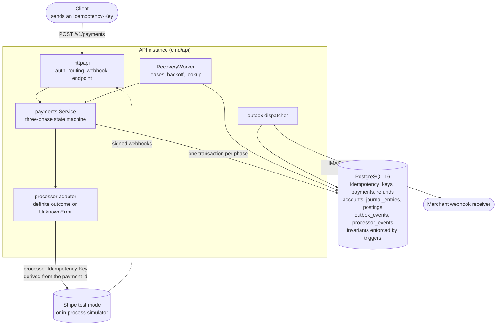
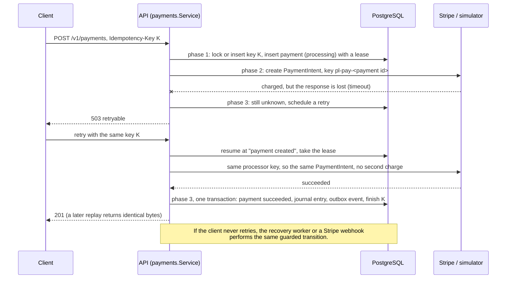
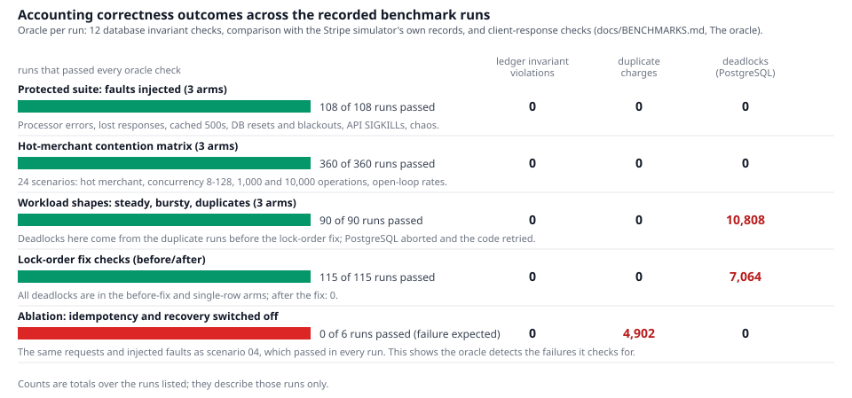
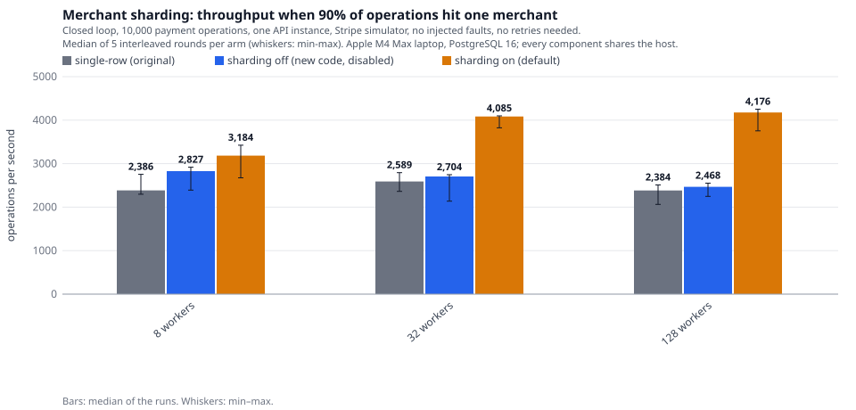
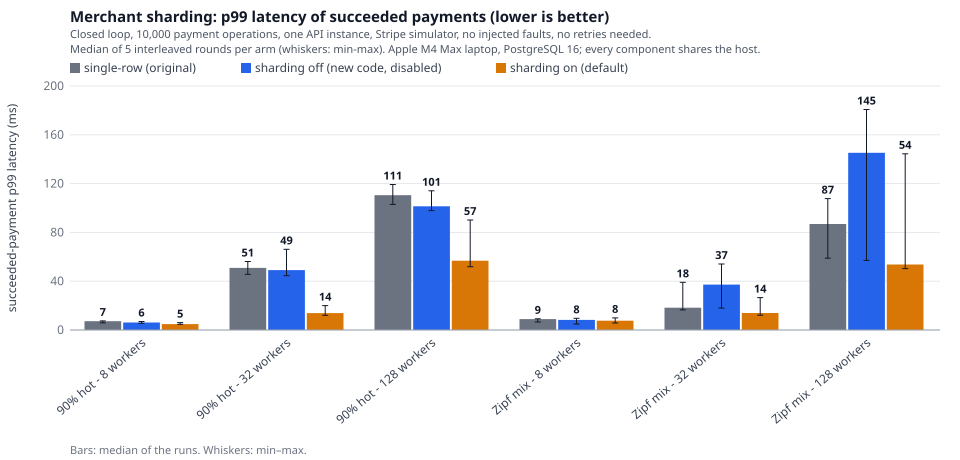
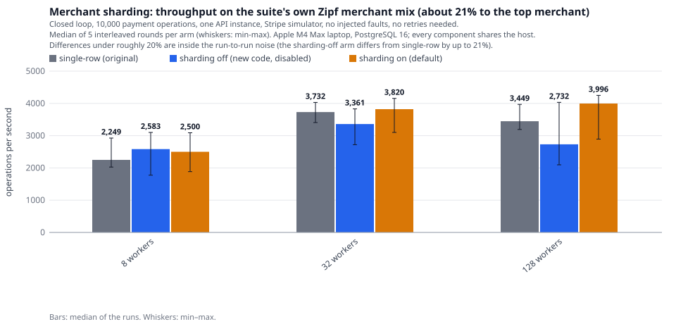
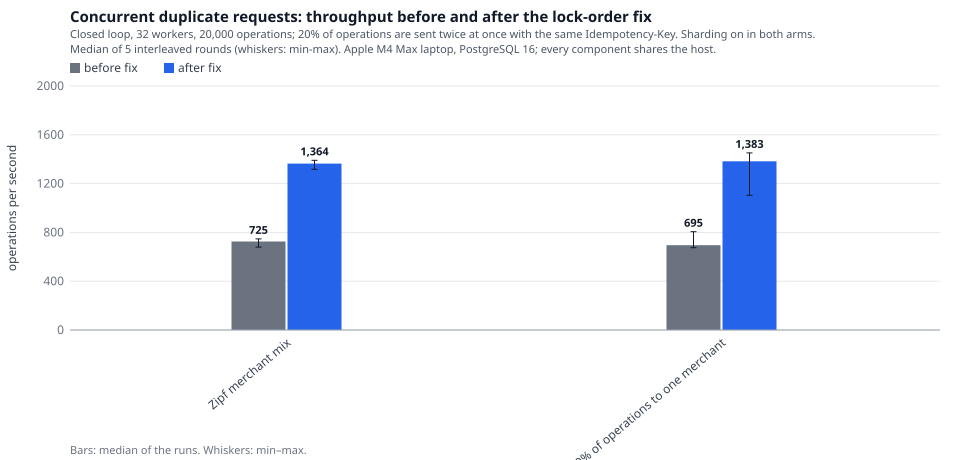
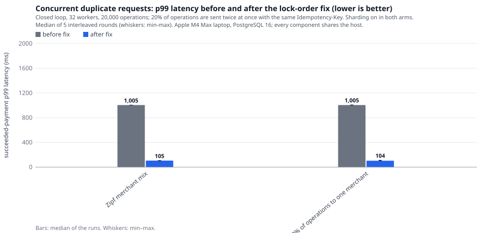

# Engineering case study: a payment ledger that stays correct under failure

A Go and PostgreSQL backend that takes card payments through Stripe (test
mode), records them in a double-entry ledger, and is built to stay correct
when the processor, the network, the database or the API process fails in the
middle of a request. This page is the guided tour: the problem, the design,
what was measured, and two things the benchmarks uncovered that I had not
predicted.

> **Status.** A reference implementation, exercised against Stripe's test mode
> and a Stripe-compatible simulator on one laptop. It is **not**
> production-certified: it has not been load-tested on server hardware, audited,
> or run against live money, and "no violations observed" below always means
> "in the runs listed", not "never".

| | |
|---|---|
| **Stack** | Go 1.26 (about 9,100 lines plus 2,100 lines of tests, 50 test functions), PostgreSQL 16, Prometheus metrics, GitHub Actions |
| **Hard parts** | unknown outcomes after a timeout, idempotent retries, crash recovery, a ledger whose invariants the *database* enforces, hot-row lock contention |
| **Evidence** | a fault-injection harness with an oracle that compares the ledger with the processor's own records; 1,174 oracle-protected runs recorded in the repository |
| **Read next** | [Architecture](ARCHITECTURE.md) · [Benchmarks](BENCHMARKS.md) · [Datasets](DATASETS.md) |

## 1. The problem

A payment API sits between a client, a card processor and a ledger, and any of
the three can fail halfway through a request. The cases that decide whether the
books stay right:

- **Unknown outcome.** The API asks the processor to charge a card and the
  response times out. The card may or may not have been charged. Treating it as
  a failure risks charging twice when the customer retries; treating it as a
  success risks recording money that never moved.
- **Retries and duplicates.** Clients retry, sometimes concurrently with the
  request still in flight. One logical payment must stay one payment.
- **Crashes.** A process killed between "the card was charged" and "the ledger
  was written" must not leave the two disagreeing.
- **Concurrency on hot rows.** Every capture updates shared balances; a few busy
  merchants make some rows very hot.
- **Proof.** "It works" is not a property you can see; the ledger has to be
  checkable against an independent source of truth.

## 2. Architecture

Any number of API instances can share one database; they coordinate only through
row locks, leases and `FOR UPDATE SKIP LOCKED`. How the pieces work together
(details in [ARCHITECTURE.md](ARCHITECTURE.md)):

- **Three atomic phases.** *Phase 1* (one transaction) locks or inserts the
  client's idempotency key and inserts the payment as `processing` with a lease.
  *Phase 2* (no transaction) calls the processor with an idempotency key derived
  from the payment id, so every retry by anyone is the same request to Stripe.
  *Phase 3* (one transaction) applies the outcome with a guarded
  `UPDATE … WHERE status = 'processing'`, enqueues the outbox event, stores the
  response under the client's key and, for a capture, writes the journal entry.
- **The Stripe adapter never guesses.** A definite answer (charged, declined) is
  applied. Timeouts, resets, 5xx, 429 and 409 are an `UnknownError`: the payment
  stays `processing` and the client gets a retryable `503`.
- **Idempotency** gives the client the same answer (byte for byte) for the same
  key, `422` for a key reused with different parameters, and lets a concurrent
  request wait for the in-flight one instead of bouncing.
- **Reconciliation and recovery** are three independent paths into the *same*
  guarded transition: a client retry, the recovery worker (expired lease, then
  backoff, then a lookup by metadata when Stripe has cached a 500, then
  `needs_review` rather than a guess) and a verified, de-duplicated Stripe
  webhook. Whichever arrives first wins; the others are no-ops.
- **The ledger** records each capture as one balanced journal entry (debit
  `processor_clearing`, credit the merchant's payable and `fee_revenue`). The
  clearing balance must always equal what the processor says it captured minus
  refunded, which is exactly what the benchmark oracle checks.

A lost response, followed by a retry and the same guarded transition:

## 3. Financial correctness guarantees

| Guarantee | Where it is enforced | Where it is checked |
|---|---|---|
| Every journal entry sums to zero and has at least two postings | Go validation **and** a `DEFERRABLE INITIALLY DEFERRED` constraint trigger at `COMMIT` | `TestDatabaseEnforcesInvariants` (raw SQL that bypasses the Go code), audit check |
| Postings and journal entries are never changed or deleted | `BEFORE UPDATE OR DELETE` triggers that raise | the same test |
| A posting's account has the journal's currency | `postings_apply` trigger | audit check |
| Cached account balance = sum of its postings | the same trigger, in the posting's transaction | audit, per account row and per logical account |
| A business event is posted at most once | `UNIQUE (kind, reference)` on journal entries | audit: one capture per succeeded payment, none otherwise |
| A card is never charged twice for one logical payment | client idempotency key, processor idempotency key, guarded status update | oracle: at most one succeeded charge per request, from the *processor's* records |
| Over-refunding is impossible | refund amounts are reserved under the payment's row lock, `CHECK (amount_refunded <= amount)` | `TestRefunds` (10 concurrent full refunds, exactly one wins) |
| What the client was told is true | answers come from the committed state | oracle: a `succeeded`/`failed` response matches the final ledger and processor state |

**What is not guaranteed.** The processor is Stripe's test mode or a simulator,
not live Stripe. Merchants, fees and fault rates in the benchmark are synthetic
(see [BENCHMARKS.md](BENCHMARKS.md#caveats--read-before-quoting-a-number)).
There is no card data (the API takes Stripe test payment-method ids), only
bearer-token authentication, one currency per account, and no multi-region
story. A run with zero oracle violations is evidence about that run.

## 4. How correctness was tested

A harness ([`internal/bench`](../internal/bench)) replays a public card dataset
(ULB, 284,807 anonymised transactions) through the real API binary while it
injects faults: processor errors, responses lost *after* the charge, cached 500s,
database connection resets and blackouts, `SIGKILL` of API processes, dropped
webhooks and a failing outbox receiver. After the load it heals all faults,
waits for recovery to finish and runs the **oracle**: twelve database invariant
checks plus a comparison of the ledger with the simulator's own record of what it
charged and refunded.

The harness has to be able to fail, so the same requests and faults also run with
idempotency, the processor key and recovery switched off (scenario 05,
"unsafe"). That ablation is the control:

*Reading the chart.* Every run with the protections on passed every check, in
suites with injected faults, in a 24-scenario contention matrix, and in the
workload and lock-order sweeps. The red bar is the control: with the protections
off, the same requests charge cards twice (817 per run, 4,902 in six runs) and the
oracle fails every time. The deadlock counts in red are real and explained in
[section 6](#6-discovery-2-the-idempotency-and-payment-lock-order-deadlock):
PostgreSQL aborted a transaction and the code retried it, which is why those runs
still pass. The counts are totals over the runs listed. They say nothing about
runs that were not made.

## 5. Discovery 1: one merchant's balance row was the bottleneck

**Where it came from.** After sharding the two system accounts that every
payment touches (`processor_clearing`, `fee_revenue`), which raised the baseline
scenario from 2,129 to 3,635 ops/s in a same-hour comparison
([BENCHMARKS.md](BENCHMARKS.md#before-and-after-sharded-system-accounts)), I
sampled which row the remaining lock waiters queued on. The largest queue, 56.5 %
of sampled tuple-lock waiters in that single diagnostic run, was one merchant's
`merchant_payable` row. The benchmark's Zipf(1.1) merchant mix sends about 21 % of
traffic to its top merchant.

**Why it is a bottleneck.** Every capture updates the merchant's cached balance
through a trigger, and a row lock is held until `COMMIT`, so one merchant's
payments serialise behind each other's commit.

**Options.**

| Option | Verdict |
|---|---|
| Change the lock order | Does not shorten how long the row is held, only how the wait chain forms |
| Shard every merchant's account | Up to 16 rows for each of thousands of merchants that never contend |
| **Shard only merchants above a posting rate** | Chosen: `ceil(rate / 25)` shard rows, at most 16; quiet merchants keep one row and no data is rewritten |

**Design.** A sliding-window rate estimate per merchant and currency
([`hotrate.go`](../internal/ledger/hotrate.go)) picks the shard count; the shard
is a hash of the payment or refund id, the same function the system accounts use.
A merchant's balance is the sum over its shard rows. No schema change was needed,
no DB-enforced invariant was touched, and the shard count can change between a
retry and the original attempt without harm, because a business event is posted
at most once (`UNIQUE (kind, reference)`). Rows are still locked in one global
order, so deadlock freedom is unchanged.

**What was measured.** Three arms, run interleaved so that drift on a shared
laptop lands on all of them: the original code, the new code with the feature
switched off, and the new code with it on.

- With 90 % of operations on one merchant, 32 and 128 closed-loop workers:
  2,589 → 4,085 ops/s (+58 %) and 2,384 → 4,176 ops/s (+75 %), faster in 5 of 5
  rounds in each cell. p99 fell from 51 to 14 ms and from 111 to 57 ms, and the
  sampled share of backend time spent waiting for row locks from 94 % to 36 % and
  from 92 % to 38 %.
- The sharded arm lands near 4,000 ops/s in every cell with 32 or more workers,
  the level of the uncontended baseline. Sharding removes the cost of skew; it
  does not raise that ceiling, and I did not find what limits it (the load
  generator, the API and PostgreSQL share the laptop's cores).
- With few writers (8 workers) a 90 % hot merchant gains +33 % in median but with
  4 of 5 rounds and overlapping ranges; a 50 % hot merchant shows no gain I can resolve (−1 % and +2 %).

The honest counterpart is the suite's own merchant mix:

On the Zipf mix the median differences (+0 % to +16 %) are inside the noise: the
*sharding-off* arm, which is the old code path, differs from the original by up
to 21 %. I therefore do **not** claim a gain there, even though the sampled
row-lock share still falls (for example 56 % to 25 % at 32 workers).

**Trade-offs.** Reading a hot merchant's balance sums up to 16 rows. The rate
estimate is per API process, so with several instances each shards a little
later. The default constants (25 postings/s per shard, at most 16) were reasoned,
not tuned. Full tables and 360 runs: [BENCHMARKS.md](BENCHMARKS.md#merchant-payable-sharding-baseline-against-adaptive).

## 6. Discovery 2: the idempotency and payment lock-order deadlock

**How it showed up.** The workload I added to test client retries sends 20 % of
payments twice at the same time with the same `Idempotency-Key`. Throughput in
that scenario was about 700 ops/s, against 2,600–3,100 for the steady Zipf
workload without duplicates, p99 was stuck near 1,005 ms, and PostgreSQL reported 1,585 to 1,929
deadlocks per five runs. The oracle **passed**: PostgreSQL aborts one transaction
of a deadlock and `db.WithTx` retries it, so nothing was lost or duplicated. The
bug was invisible to every correctness check and visible only in a metric.

**Root cause**, read from PostgreSQL's own log:

| | request finishing its payment | concurrent duplicate request |
|---|---|---|
| first lock | `UPDATE payments …` (the payment row) | `SELECT … FROM idempotency_keys … FOR UPDATE` (the key row) |
| then waits for | `UPDATE idempotency_keys …` (the key row) | `SELECT … FROM payments … FOR UPDATE` (the payment row) |

Opposite orders on two rows form a cycle. PostgreSQL only looks for a deadlock
after `deadlock_timeout`, one second by default, which is why p99 sat at 1,005 ms.

**Fix.** Every path that updates a payment or refund *and* finishes the key now
takes the key row first (`idempotency.Lock`), so the order is key, then
payment or refund, then accounts, everywhere. Two tests reproduce it
(`TestConcurrentDuplicatesDoNotDeadlock`,
`TestConcurrentDuplicateRefundsDoNotDeadlock`; both fail without the fix, 16 and
7–11 retried transactions in the runs I made) and a new counter,
`ledger_tx_retries_total`, makes a recurrence visible in production.

After the fix, in five interleaved rounds: deadlocks fell from 1,585–1,865 to 0,
throughput from 725 to 1,364 ops/s (Zipf mix) and from 695 to 1,383 ops/s (hot
merchant), and p99 from about 1,005 ms to about 105 ms. The remaining ~105 ms is
consistent with the 100 ms poll interval at which a request waits for its in-flight
twin; I did not investigate it further. The fix adds one statement per request. A
first five-round check made that look like a cost; ten more interleaved rounds
of the steady scenarios showed no cost I could resolve (median +1.5 % and +5.0 %).
Details: [BENCHMARKS.md](BENCHMARKS.md#duplicate-requests-and-a-lock-order-bug-the-benchmark-found).

## 7. Other database and reliability work, with measured effects

| Change | Problem addressed | Measured effect |
|---|---|---|
| Sharded system accounts | every capture serialised on two rows | baseline 2,129 → 3,635 ops/s (+71 %); database-fault scenario 288 → 868 ops/s ([details](BENCHMARKS.md#before-and-after-sharded-system-accounts)) |
| Heartbeat leases and a bounded wait for in-flight requests | a dead process held its payment for the whole lease and every retry got `409` | clients that exhausted 12 attempts: 0.30 % → 0.00 % (database faults), 0.26 % → 0.00 % (API crashes), 0.44 % → 0.00 % (chaos) ([details](BENCHMARKS.md#before-and-after-heartbeat-leases)) |
| Reusing HTTP connections in the outbox dispatcher | about 9,000 sockets in `TIME_WAIT` at 2,000 events/s | about 300 after the fix ([details](BENCHMARKS.md#bugs-the-benchmark-found)) |
| Account rows locked in one global order | deadlocks between concurrent postings | `TestConcurrentPosting` |

## 8. Results at a glance

| Result | Numbers (medians of interleaved runs on one laptop) |
|---|---|
| Protections off vs on, same faults | 817 duplicate charges per run vs 0 in every protected run |
| Oracle verdicts | 1,174 protected runs passed, 39 runs of the ablation failed, as designed |
| 90 % hot merchant, 128 workers, 10,000 operations | 2,384 → 4,176 ops/s (+75 %), p99 111 → 57 ms |
| Suite's Zipf merchant mix | no effect that 5–7 rounds can resolve |
| Concurrent duplicate requests | 725 → 1,364 ops/s, deadlocks about 1,800 per five runs → 0, p99 about 1,005 → 105 ms |

## 9. Methodology, hardware and reproducibility

- **Every run** creates a fresh migrated database, starts the Stripe simulator
  behind an HTTP fault proxy and a TCP fault proxy in front of PostgreSQL,
  starts the real API binary as a subprocess, creates merchants through the API,
  replays dataset rows through the public API with a client that retries the way a
  well-written integration does, heals the faults, drains, audits and runs the
  oracle. Fault decisions are pure functions of the seed and the request, so
  repeated runs inject the same faults into the same requests.
- **Comparisons are interleaved.** For each scenario and round every arm runs
  once, back to back, with the order rotated between rounds
  ([`scripts/bench-interleaved.sh`](../scripts/bench-interleaved.sh)). Tables
  report the median, the min–max range, the run-to-run spread and in how many
  rounds an arm beat the reference; no significance claim goes beyond that.
- **Hardware.** Apple M4 Max (14 cores), 36 GiB, macOS 26.5.2, PostgreSQL 16.15
  from Homebrew with `fsync` and `synchronous_commit` on and 512 MB of shared
  buffers. The database, the API process, the simulator, the fault proxies and the
  load generator share this one machine with a normal desktop session. Absolute
  numbers are therefore not comparable with servers or with other systems; on
  macOS, `fsync` does not force the drive's cache the way a server's would.
- **Observed variance.** Run-to-run spread within one arm is commonly 20–70 % for
  the short closed-loop runs, correlated in time, and it persisted after I moved
  the database out of an iCloud-synced folder that a sync daemon was working on. I could
  not identify its remaining sources. This is why only interleaved arms are
  compared and effects under roughly 20 % are not claimed.
- **Not measured.** Real Stripe at scale (one 300-payment run exists), several API
  instances for the sharding change, any server hardware, other values of the
  shard threshold, and the PaySim and IBM AML datasets (the adapters exist and
  are unit-tested but were never run on the real files).
- **Reproduce.** `make db-up && make dataset && make build`, then the commands
  under [Reproduce](BENCHMARKS.md#environment) build the original binary from
  commit `e808fd0` and run the three-arm comparisons; `make bench-charts`
  regenerates every chart on this page from the committed result files in
  [`bench/sweeps`](../bench/sweeps) (`scripts/make-charts.sh`).

## 10. Trade-offs and what I would do next

- Measure on server hardware and with several API instances; share the merchant
  rate estimate between instances, or shard by a configured list, if per-process
  estimates turn out to lag.
- Find what limits the ~4,000 ops/s ceiling (a CPU profile of the API and the
  load generator) before tuning the shard threshold and cap.
- Run the PaySim and IBM AML adapters on the real datasets and compare their
  merchant skew with the synthetic Zipf mix.
- Run a larger real-Stripe test-mode campaign, including declines, which has not
  been done.
- Alert on a non-zero rate of `ledger_tx_retries_total{reason="deadlock"}`; a
  dashboard would have shown this bug long before any correctness check could.

## 11. Where to look in the code

| Topic | Code | Tests |
|---|---|---|
| Double-entry ledger, DB-enforced invariants | [`internal/ledger`](../internal/ledger/ledger.go), [migrations](../internal/db/migrations) | `ledger_test.go`, `shards_test.go` |
| Merchant sharding by rate | [`hotrate.go`](../internal/ledger/hotrate.go), `captureAccounts` in [`service.go`](../internal/payments/service.go) | `hotrate_test.go`, `TestHotMerchantPayableIsSharded`, `TestHotMerchantConcurrentCaptures` |
| Payment state machine, leases, recovery | [`internal/payments`](../internal/payments/service.go), [`recovery.go`](../internal/payments/recovery.go) | `lease_test.go`, `TestRecoveryWorkerResolves` |
| Idempotency keys and lock order | [`internal/idempotency`](../internal/idempotency/idempotency.go) | `TestConcurrentSameKey`, `TestConcurrentDuplicatesDoNotDeadlock` |
| Stripe adapter, webhook verification | [`internal/processor`](../internal/processor/processor.go), [`internal/stripe`](../internal/stripe/webhook.go) | `TestVerifySignature`, `TestWebhookDuplicateDelivery` |
| Audit and the benchmark oracle | [`internal/audit`](../internal/audit/audit.go), [`oracle.go`](../internal/bench/oracle.go) | `audit_test.go` |
| Benchmark harness, charts | [`internal/bench`](../internal/bench), [`cmd/bench`](../cmd/bench/main.go) | `bench_test.go` |
| CI | [`.github/workflows`](../.github/workflows) | build, vet, gofmt, unit, race, PostgreSQL integration, govulncheck, gitleaks |
